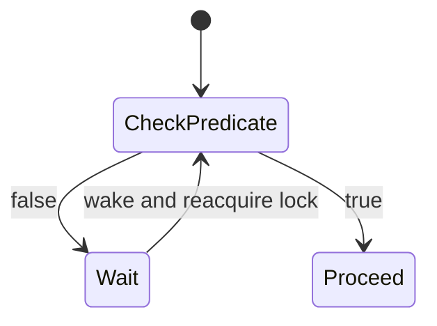

# 35. Why is it important to check conditions in a loop when waiting?

> Section: Synchronization and Locks · Java 8 baseline · [Section guide](README.md)

## Answer and deep dive

Use `while (!predicate) wait()` because a wakeup does not establish that the predicate holds. The thread may wake spuriously, another waiter may consume the resource first, or a notification may have been intended for a different condition.

```java
lock.lock();
try {
    while (queue.isEmpty()) {
        notEmpty.await();
    }
    return queue.remove();
} finally {
    lock.unlock();
}
```

For a timeout, calculate an absolute deadline and recompute the remaining duration after each return; restarting the full timeout on every wake can wait longer than promised.

## Mermaid: loop invariant



## Pitfall / architect insight

Check and wait must be performed under the same lock that protects the predicate. Otherwise a state change between the check and wait can be missed.

## Related question

Next: [36. wait() versus sleep()](36.%20wait%28%29%20versus%20sleep%28%29.md).
