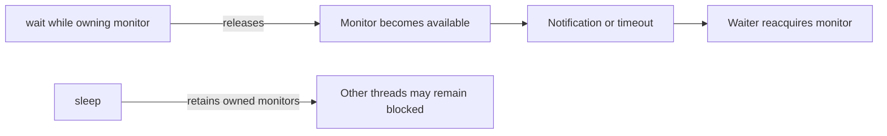

# 36. What is the difference between wait() and sleep()?

> Section: Synchronization and Locks · Java 8 baseline · [Section guide](README.md)

## Answer and deep dive

`wait()` is a monitor-coordination operation: the caller must own that object's monitor, and `wait()` releases that monitor while the thread waits. The thread must reacquire it before continuing. `sleep()` pauses the current thread for a duration, needs no monitor, and retains monitors it already owns.

```java
synchronized (lock) {
    while (!ready) {
        lock.wait(); // releases lock
    }
}
Thread.sleep(100); // does not release any held monitor
```

Both can be interrupted. Use wait/conditions for coordination and sleep only when a delay itself is intended.

## Mermaid: monitor behavior



## Pitfall / architect insight

Sleeping for a guessed interval is not a synchronization protocol; it creates timing-dependent failures. Model readiness with a guarded predicate, condition, latch, or other coordination primitive.

## Related question

Next: [37. notify() versus notifyAll()](37.%20notify%28%29%20versus%20notifyAll%28%29.md).
