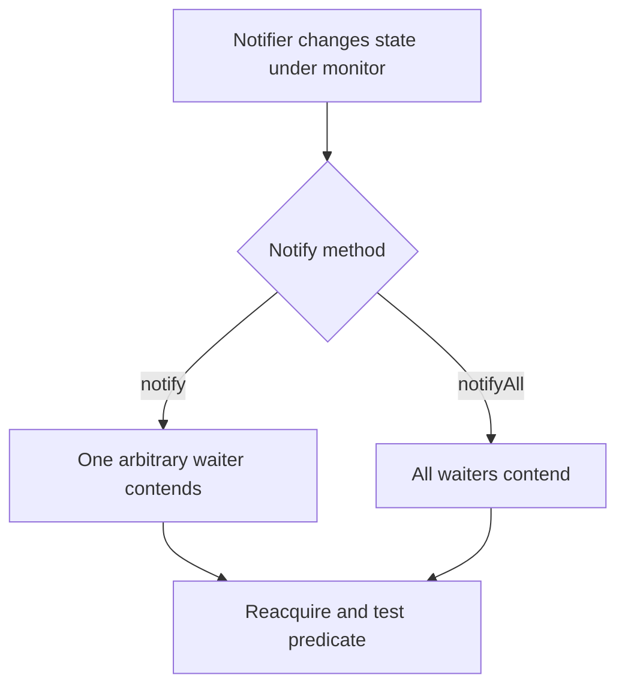

# 37. How does notify() differ from notifyAll()?

> Section: Synchronization and Locks · Java 8 baseline · [Section guide](README.md)

## Answer and deep dive

`notify()` selects one arbitrary thread from an object's wait set; `notifyAll()` makes all waiters eligible to contend for the monitor. Neither transfers the monitor immediately: waiters continue only after the notifying thread releases it and they reacquire it. Every waiter must retest its predicate.

```java
synchronized (lock) {
    ready = true;
    lock.notifyAll();
}
```

`notifyAll()` is safer when waiters have different predicates or when choosing the correct waiter cannot be proven. `notify()` can be appropriate when there is a single predicate and one awakened waiter is guaranteed to make progress.

## Mermaid: notification paths



## Pitfall / architect insight

`notifyAll()` can cause a contention burst, but premature optimization to `notify()` can deadlock or stall a protocol. Prove waiter-selection correctness before using it.

## Related question

Next: [38. notify() with no waiters](38.%20notify%28%29%20with%20no%20waiters.md).
