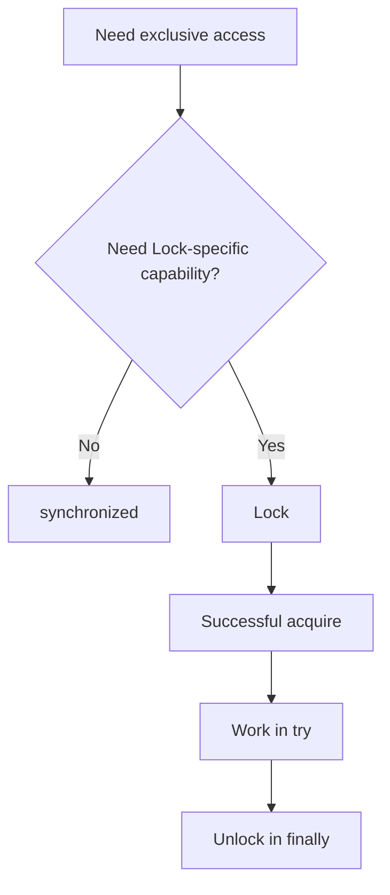

# 40. When should you prefer locks over synchronized blocks?

> Section: Synchronization and Locks · Java 8 baseline · [Section guide](README.md)

## Answer and deep dive

Prefer `synchronized` for ordinary mutual-exclusion sections because monitor ownership follows lexical scope and release is automatic. Choose `Lock` when a required capability is not provided conveniently by intrinsic monitors: timed or interruptible acquisition, optional fairness, multiple `Condition`s, or specific lock operations.

```java
if (lock.tryLock()) {
    try {
        update();
    } finally {
        lock.unlock();
    }
}
```

Unlock only after successful acquisition, keep the lock reference stable, and define behavior for interruption and timeout.

## Mermaid: explicit-lock decision



## Pitfall / architect insight

Explicit locking adds cleanup paths and makes missed unlocks possible. Document lock ordering, test exceptional paths, and do not use it solely on an unmeasured assumption that it is faster.

## Related question

Previous section: [39. What is lock contention](39.%20What%20is%20lock%20contention.md).
