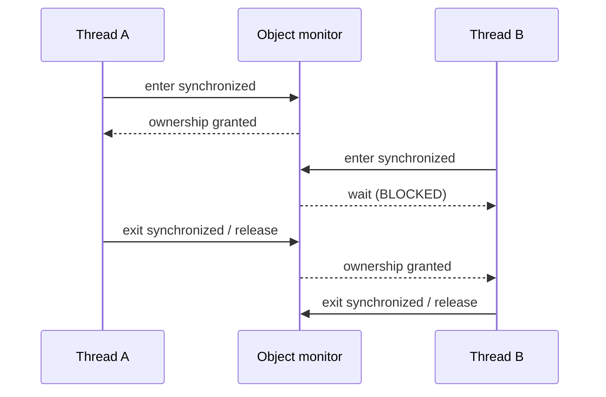
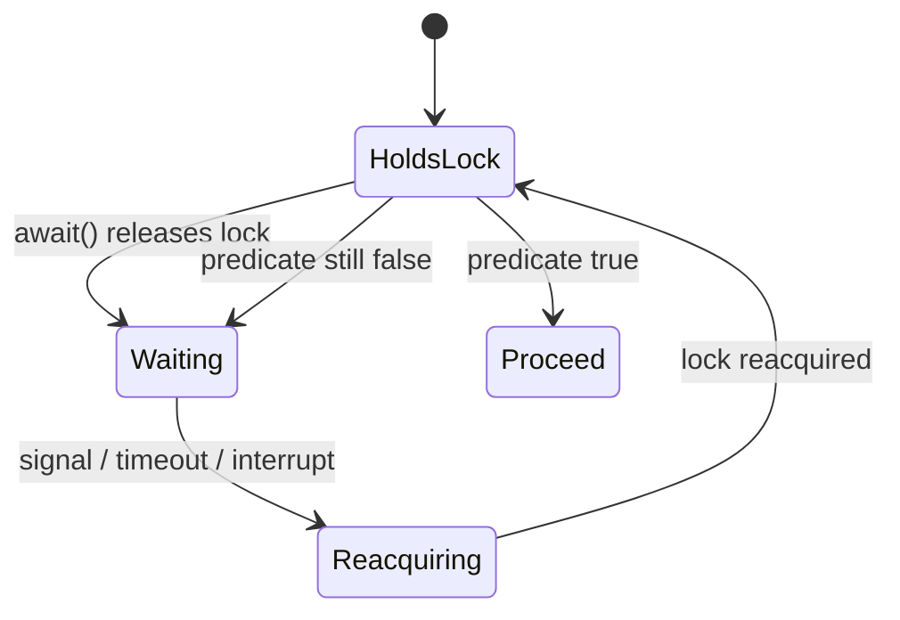
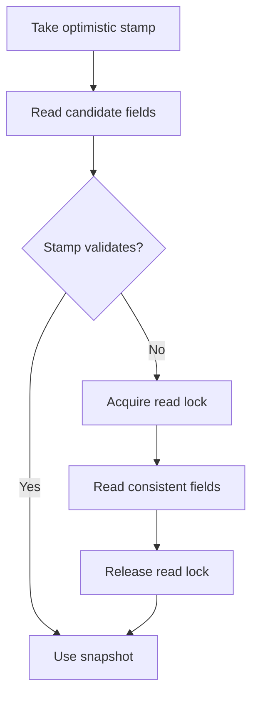

# 2. Synchronization and Locks

> Complete guide to questions 21–40 in the [master index](../00-INDEX.md). The examples use Java 8 APIs unless noted.

**Related code:** [`javasynchronize`](../../src/com/java/javasynchronize/), [`ReentrantLockDemo`](../../src/com/java/multithreading/interview/questions/ReentrantLockDemo.java), [`ReadWriteStampedLockDemo`](../../src/com/java/multithreading/interview/questions/ReadWriteStampedLockDemo.java), [`SpuriousWakeupDemo`](../../src/com/java/multithreading/interview/questions/SpuriousWakeupDemo.java).

## Answers

### 21. How does `synchronized` work internally?

Entering a synchronized method or block acquires that object's monitor; leaving it releases the monitor, including when control exits exceptionally. Only one thread at a time owns a monitor. The JVM may optimize uncontended locking, but programs must rely on the Java language guarantees, not a particular lock implementation.

### 22. What is a monitor?

A monitor is the per-object synchronization mechanism associated with every Java object. It provides mutual exclusion and an associated wait set used by `wait`, `notify`, and `notifyAll`. A thread must own the monitor before calling those methods, and `wait` atomically releases it while waiting.

### 23. What are intrinsic locks?

An intrinsic lock (monitor lock) is acquired implicitly by `synchronized`. An instance synchronized method locks `this`; a static synchronized method locks the declaring `Class` object; a synchronized block locks the expression's object. The lock is reentrant and released automatically at block or method exit.

### 24. Intrinsic versus explicit locks

`synchronized` is lexically scoped, automatically released, and integrates directly with monitor wait sets. `Lock` implementations such as `ReentrantLock` require `unlock()` in `finally` but provide timed and interruptible acquisition, optional fairness, multiple `Condition`s, and inspection methods. Prefer the simpler intrinsic lock unless a needed capability justifies explicit lock management.

### 25. What is a reentrant lock?

A reentrant lock lets its owning thread acquire the same lock repeatedly without deadlocking itself. Each successful acquisition increments a hold count; each corresponding unlock decrements it, and the lock becomes available only when the count reaches zero. `synchronized` and `ReentrantLock` are both reentrant.

### 26. How does fairness affect `ReentrantLock`?

A fair `ReentrantLock` generally favors the longest-waiting thread under contention, reducing starvation risk at a throughput cost. Fairness is not a guarantee of OS scheduling fairness, and untimed `tryLock()` may barge even on a fair lock. Use fairness only when measured requirements justify the trade-off.

### 27. How do you use timed `tryLock()`?

Call `tryLock(timeout, unit)`, check its boolean result, and always unlock only after successful acquisition:

```java
if (lock.tryLock(200, TimeUnit.MILLISECONDS)) {
    try {
        updateSharedState();
    } finally {
        lock.unlock();
    }
} else {
    recordBusyOrRetry();
}
```

The call is interruptible; define an interruption policy and avoid silently treating timeout as success.

### 28. What is `ReadWriteLock` for?

It separates shared read access from exclusive write access. Multiple readers may hold the read lock together, while a writer excludes both readers and other writers. It is useful when reads greatly outnumber writes and the protected work is substantial enough to repay the extra locking complexity.

### 29. How can `ReentrantReadWriteLock` improve concurrency?

Concurrent reads need not serialize, which can improve throughput for read-heavy structures. Writes remain exclusive, and a writer cannot safely upgrade by acquiring the write lock while holding a read lock. Downgrading is supported: acquire write, update, acquire read, then release write. Benchmark; short critical sections or frequent writes may favor a simpler lock.

### 30. What is `StampedLock` and how does it differ?

`StampedLock` (Java 8) offers read, write, and optimistic-read modes. Its stamps are validation tokens, not ownership; it is not reentrant and does not implement `ReadWriteLock`. It can improve read-mostly workloads, but is easier to misuse and has no condition variables. Keep critical sections short and follow its lock/unlock API exactly.

### 31. What is optimistic locking in `StampedLock`?

An optimistic read takes a stamp without blocking a writer, reads fields, then validates that no write overlapped. If validation fails, discard the possibly inconsistent snapshot and retry under a read lock. Copy the needed fields to locals before validation; do not perform irreversible actions using data before validation.

```java
long stamp = lock.tryOptimisticRead();
int observed = value;
if (!lock.validate(stamp)) {
    stamp = lock.readLock();
    try { observed = value; }
    finally { lock.unlockRead(stamp); }
}
```

### 32. How do condition variables work?

A `Condition` associates a wait set with a `Lock`, allowing multiple distinct predicates on one lock. `await()` releases the associated lock and suspends; after a signal or interruption it reacquires the lock before returning or throwing. The condition is a notification mechanism, not the predicate itself.

### 33. How do you use `await()` and `signal()`?

Guard the shared predicate with the same lock, wait in a `while` loop, mutate the predicate before signalling, and unlock in `finally`. `signal()` wakes one waiter; `signalAll()` wakes all, which then contend to reacquire the lock.

```java
lock.lock();
try {
    while (!ready) readyCondition.await();
    consume();
} finally {
    lock.unlock();
}
```

### 34. What is a spurious wakeup?

A waiting thread may return from `Object.wait()` or `Condition.await()` without the intended notification, and notifications can also be intended for a different predicate. Therefore a return from waiting never proves the condition. Recheck the predicate under its lock before proceeding.

### 35. Why check wait conditions in a loop?

The loop handles spurious wakeups, competing waiters that consume the resource first, and `notifyAll()` waking threads whose predicates differ. Use `while (!predicate) await()` with the predicate protected by the same lock. For timed waits, compute a deadline and recompute remaining time after each wakeup.

### 36. `wait()` versus `sleep()`

`wait()` requires monitor ownership, releases that monitor while waiting, and resumes only after notification/timeout/interruption and reacquisition. `sleep()` needs no monitor and retains every monitor already held. Use waiting for coordination on a condition; use sleep only for timing, never as a correctness signal.

### 37. `notify()` versus `notifyAll()`

`notify()` chooses one arbitrary waiter from that object's wait set; `notifyAll()` wakes every waiter, which then compete for the monitor and must retest their predicates. `notifyAll()` is safer when waiters have different predicates or when choosing the right waiter is not provable; it may cause a contention burst.

### 38. `notify()` with no waiters

The notification is lost; it is not remembered for a future waiter. Correct designs store state in a predicate (or use a queue, semaphore, latch, or other utility), update it under synchronization, then notify. A later thread checks the predicate before waiting, avoiding reliance on notification timing.

### 39. What is lock contention?

Contention occurs when threads frequently queue for the same lock. It can reduce throughput, increase latency variance, cause blocked threads and context switches, and create a scalability ceiling. Diagnose with thread dumps and lock profiling; shorten critical sections and reduce shared mutable state before introducing finer-grained synchronization.

### 40. When prefer explicit locks?

Prefer `synchronized` for ordinary mutually exclusive critical sections because scope and release are automatic. Use `Lock` when timed/interruptible acquisition, fairness, multiple conditions, or lock-specific operations are required. If using explicit locks, keep the lock reference stable and pair every successful acquisition with `unlock()` in `finally`.

## Diagrams

### Monitor acquisition and release



### Condition waiting



### Optimistic read and validation



## Architect / Tech-Lead checklist

- State the invariant protected by each lock and the lock-ordering rule for code that takes more than one.
- Never use `sleep()` to wait for another thread, and never assume a notification is stored.
- Measure contention before changing lock granularity; re-check correctness after each optimization.
- For interruption, timeout, and lock-acquisition failure, define an explicit caller-visible policy.

**Runnable demonstrations:** [`ReentrantLockDemo`](../../src/com/java/multithreading/interview/questions/ReentrantLockDemo.java), [`ReadWriteStampedLockDemo`](../../src/com/java/multithreading/interview/questions/ReadWriteStampedLockDemo.java), [`SpuriousWakeupDemo`](../../src/com/java/multithreading/interview/questions/SpuriousWakeupDemo.java).
