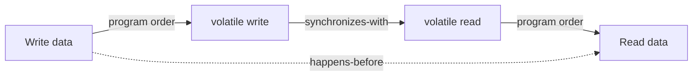

# 41. What is the happens-before relationship?

> Section: Java Memory Model · Java 8 baseline · [Section guide](README.md)

## Answer and deep dive

Happens-before is a partial order defined by the Java Memory Model. If action A happens-before action B, effects of A are visible to B and A is ordered before B for the guarantees of the model. It is built from program order and synchronization actions, and is transitive.

Examples include monitor unlock before a later lock of the same monitor, volatile write before a subsequent read of that field, actions before `Thread.start()` before actions in the new thread, and thread actions before a successful `join()` return.

## Mermaid: transitive visibility

## Pitfall / architect insight

Without a happens-before path, conflicting unsynchronized accesses can form a data race. Source-code order alone does not establish cross-thread visibility.

## Related question

Next: [42. How does synchronized establish happens-before](42.%20How%20does%20synchronized%20establish%20happens-before.md).
