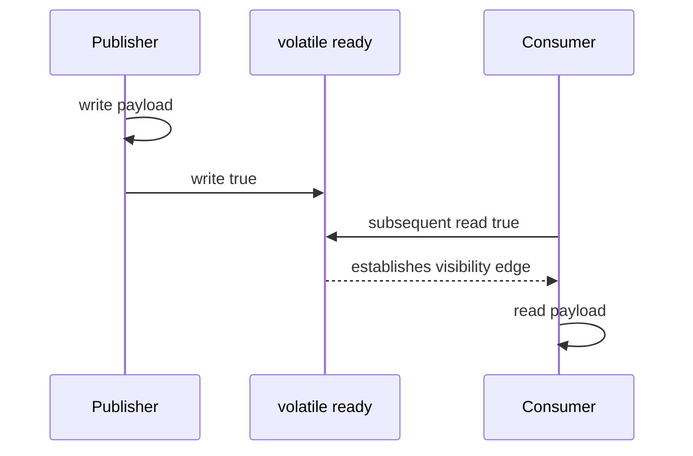

# 43. How does volatile establish happens-before?

> Section: Java Memory Model · Java 8 baseline · [Section guide](README.md)

## Answer and deep dive

A write to volatile field `v` happens-before every subsequent read of `v` in synchronization order. This edge publishes actions before the write to a thread that reads the updated volatile value.

```java
int payload;              // written before publication
volatile boolean ready;

// Publisher: payload = 42; ready = true;
// Consumer:
if (ready) {
    use(payload);         // sees the published write to payload
}
```

The publication protocol is sound only when the reader observes the relevant volatile write and the payload is not later modified without further coordination.

## Mermaid: volatile publication



## Pitfall / architect insight

Volatile does not make compound operations atomic or protect a multi-field invariant. Use a lock or atomic operation when the operation must be indivisible.

## Related question

Next: [44. How does Thread.start() establish happens-before](44.%20How%20does%20Thread.start%28%29%20establish%20happens-before.md).
