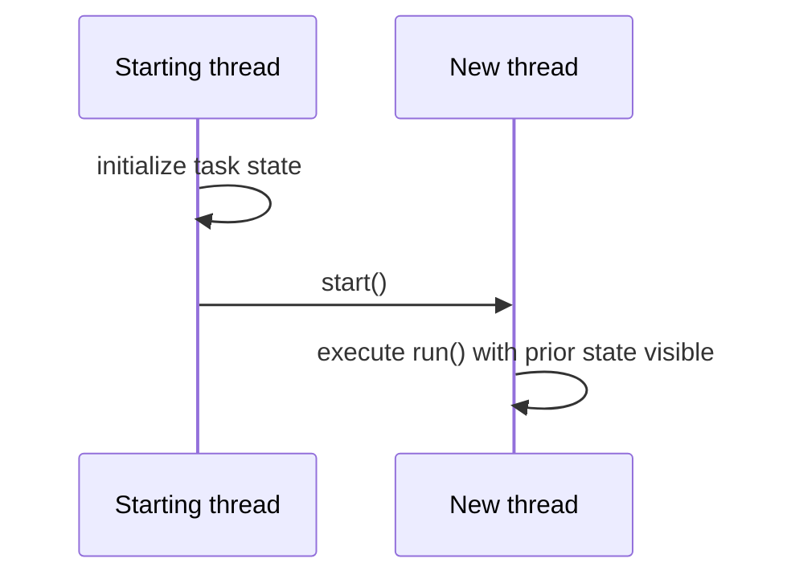

# 44. How does Thread.start() establish happens-before?

> Section: Java Memory Model · Java 8 baseline · [Section guide](README.md)

## Answer and deep dive

All actions in a thread before it invokes `t.start()` happen-before any action in the started thread. This makes initialization done before `start()` visible to the new thread.

```java
final class Task implements Runnable {
    private final int input;
    Task(int input) { this.input = input; }
    public void run() { process(input); }
}

Thread t = new Thread(new Task(42));
t.start();
```

This edge does not protect later unsynchronized changes to the task state. `start()` must be called on the `Thread` object; calling its `run()` method directly just executes on the caller's thread.

## Mermaid: startup edge



## Pitfall / architect insight

Treat task configuration as immutable after submission when possible. If a task's inputs remain mutable, establish additional synchronization for updates.

## Related question

Next: [45. How does Thread.join() establish happens-before](45.%20How%20does%20Thread.join%28%29%20establish%20happens-before.md).
