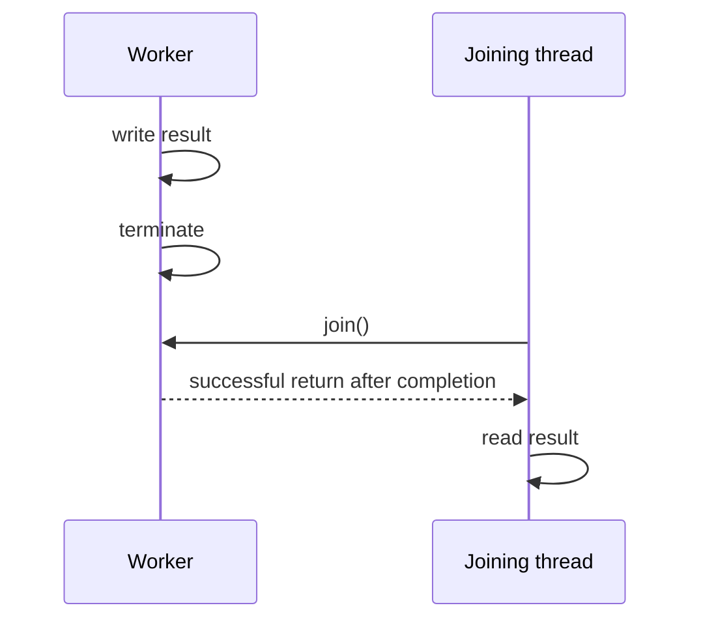

# 45. How does Thread.join() establish happens-before?

> Section: Java Memory Model · Java 8 baseline · [Section guide](README.md)

## Answer and deep dive

All actions performed by a thread happen-before another thread successfully returns from `join()` on it. The joining thread can read the completed thread's results after the join, provided no other thread races to modify them.

```java
int[] result = new int[1];
Thread worker = new Thread(() -> result[0] = 42);
worker.start();
worker.join();
System.out.println(result[0]); // sees completed worker's write
```

If `join()` is interrupted, it throws `InterruptedException` before the successful-return guarantee applies. Handle the interruption rather than assuming the worker has finished.

## Mermaid: completion visibility



## Pitfall / architect insight

A timed join returning does not prove completion; check `isAlive()` or use a completion primitive if the timeout may expire.

## Related question

Next: [46. What guarantees does volatile provide](46.%20What%20guarantees%20does%20volatile%20provide.md).
