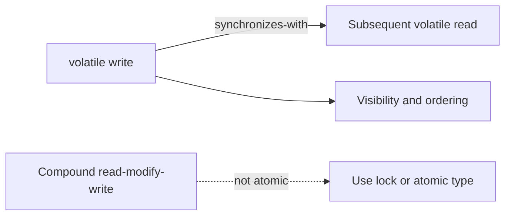

# 46. What guarantees does volatile provide?

> Section: Java Memory Model · Java 8 baseline · [Section guide](README.md)

## Answer and deep dive

Volatile reads and writes are individually atomic, participate in synchronization order, and establish visibility and ordering edges. A volatile write is visible to a subsequent read of that field. Volatile is useful for independent state flags and carefully designed publication protocols.

```java
private volatile boolean running = true;

void stop() { running = false; }
void runLoop() {
    while (running) {
        doWork();
    }
}
```

This works because the loop repeatedly reads the volatile flag. Volatile does not provide mutual exclusion, a consistent snapshot of several fields, or atomic read-modify-write.

## Mermaid: volatile contract



## Pitfall / architect insight

Do not mark one field volatile and assume neighboring ordinary fields automatically form a coherent live state. Document the precise publication protocol or guard the invariant with a lock.

## Related question

Next: [47. Why is volatile insufficient for increments](47.%20Why%20is%20volatile%20insufficient%20for%20increments.md).
