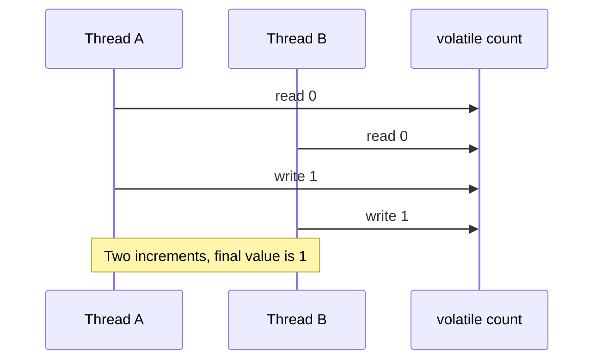

# 47. Why is volatile insufficient for atomic increments?

> Section: Java Memory Model · Java 8 baseline · [Section guide](README.md)

## Answer and deep dive

`count++` is a read, addition, and write—not a single atomic action. Two threads can read the same value and both write the same incremented result. Making `count` volatile guarantees visibility and ordering of each individual access, not atomicity of the whole sequence.

```java
private final AtomicInteger count = new AtomicInteger();

void increment() {
    count.incrementAndGet();
}
```

Use an atomic counter for an independent count, a lock when the increment belongs to a larger invariant, or a `LongAdder` for high-contention statistics where a non-instantaneous sum is acceptable.

## Mermaid: lost update



## Pitfall / architect insight

Choose the primitive based on semantics: atomics protect one variable; locks protect related state and multi-step invariants.

## Related question

Next: [48. How does volatile prevent reordering](48.%20How%20does%20volatile%20prevent%20reordering.md).
