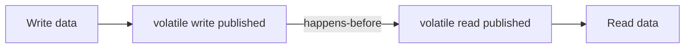

# 48. How does volatile prevent instruction reordering?

> Section: Java Memory Model · Java 8 baseline · [Section guide](README.md)

## Answer and deep dive

The JMM constrains the observable ordering of operations around volatile reads and writes. In particular, writes before a volatile publication cannot become visible after it in a way that violates the model, and actions after a volatile read cannot be observed as though they happened before that read.

The compiler, JIT, and runtime use target-appropriate barriers or instructions to preserve these semantics. A program should rely on the volatile contract, not assume a specific processor's memory model.

```java
int data;
volatile boolean published;
// Writer: data = 7; published = true;
// Reader: if (published) use(data);
```

## Mermaid: ordering boundary



## Pitfall / architect insight

Volatile ordering only helps when threads communicate through the relevant volatile access. It does not make unrelated unsynchronized state safe or turn compound operations into transactions.

## Related question

Next: [49. What is safe publication](49.%20What%20is%20safe%20publication.md).
