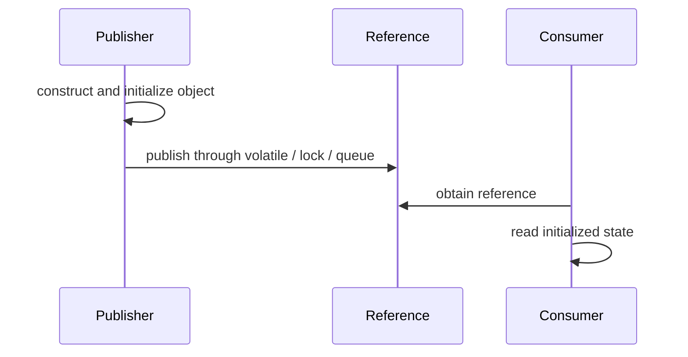

# 49. What is safe publication of objects?

> Section: Java Memory Model · Java 8 baseline · [Section guide](README.md)

## Answer and deep dive

Safe publication makes a reference visible to other threads only after the object's invariants have been established. Common mechanisms include class initialization, a volatile reference, synchronized handoff, final-field construction guarantees, or transfer through a thread-safe collection or queue.

```java
private volatile Config config;

void publish(Config value) {
    config = value; // construct fully before publishing
}

Config current() {
    return config;
}
```

Safe publication covers the writes that happen-before the receiving thread obtains the reference. It does not make later unsynchronized mutation of the object safe.

## Mermaid: publication



## Pitfall / architect insight

Separate the question “was this object safely published?” from “are later mutations thread-safe?” Prefer immutable objects to reduce both problems.

## Related question

Next: [50. What is the out-of-thin-air problem](50.%20What%20is%20the%20out-of-thin-air%20problem.md).
