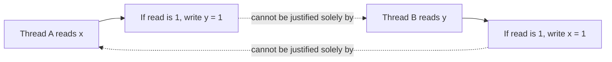

# 50. What is the out-of-thin-air value problem?

> Section: Java Memory Model · Java 8 baseline · [Section guide](README.md)

## Answer and deep dive

An out-of-thin-air value is a value that appears to have no valid causal source in an execution. A classic thought experiment imagines two threads conditionally assigning values based on each other's reads, with speculation apparently creating a self-justifying cycle.

The JMM's causality rules constrain legal executions so arbitrary values cannot be justified by circular reasoning. This is a model-level guarantee about permitted executions, not a synchronization mechanism to use in application code.

## Mermaid: forbidden causal cycle

## Pitfall / architect insight

Do not try to exploit speculative or racy behavior for a protocol. Use explicit synchronization so the causal source of every shared value is clear.

## Related question

Next: [51. Which operations are atomic](51.%20Which%20operations%20are%20atomic.md).
