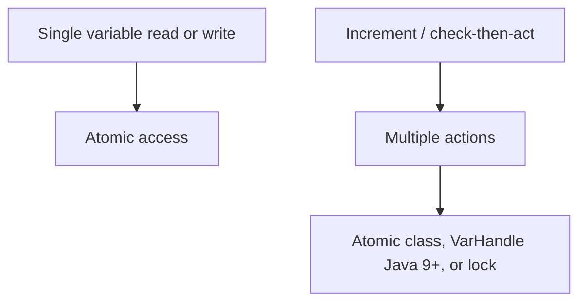

# 51. Which operations are atomic in Java?

> Section: Java Memory Model · Java 8 baseline; `VarHandle` was added in Java 9 · [Section guide](README.md)

## Answer and deep dive

Reads and writes of references and primitive variables are atomic in modern Java, including `long` and `double`. Volatile accesses to these variables are also atomic. Atomicity of an individual access does not make a compound expression atomic: `x++` still has multiple steps.

For atomic read-modify-write, use a suitable `Atomic*` class (Java 5+), a lock, or `VarHandle` operations (Java 9+). Choose an API that expresses the required memory ordering and invariant.

```java
AtomicInteger counter = new AtomicInteger();
counter.incrementAndGet(); // atomic read-modify-write
```

## Mermaid: operation granularity



## Pitfall / architect insight

Atomic access is not the same as visibility of unrelated variables or atomicity of a multi-field invariant. Identify the exact operation boundary that must be indivisible.

## Related question

Next: [52. Why did pre-Java 5 permit torn long/double accesses](52.%20Why%20did%20pre-Java%205%20permit%20torn%20long%20double%20accesses.md).
