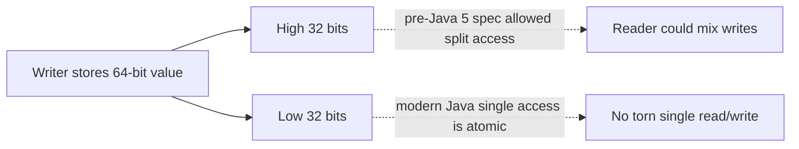

# 52. Why were long and double not atomic pre-Java 5?

> Section: Java Memory Model · Historical specification detail · [Section guide](README.md)

## Answer and deep dive

Before Java 5, the specification permitted non-volatile 64-bit `long` and `double` reads or writes to be treated as two 32-bit operations on some implementations. A racing reader could therefore theoretically observe a value assembled from parts of two writes.

The modern JMM guarantees atomic reads and writes for all variables, including non-volatile `long` and `double`. This is only single-access atomicity: it does not provide visibility for arbitrary races or make a compound update such as `value++` atomic.

## Mermaid: historical possibility

## Pitfall / architect insight

Do not carry historical caveats into claims about current Java guarantees, but do not mistake atomic reads for a complete synchronization protocol.

## Related question

Next: [53. Atomicity, visibility, and ordering](53.%20Atomicity%2C%20visibility%2C%20and%20ordering.md).
