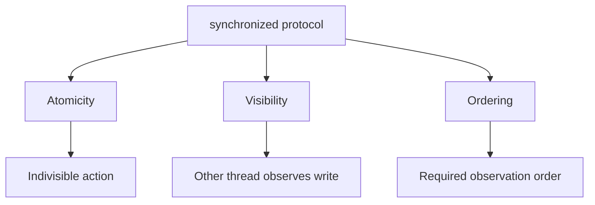

# 53. What’s the difference between atomicity, visibility, and ordering?

> Section: Java Memory Model · Java 8 baseline · [Section guide](README.md)

## Answer and deep dive

These are distinct properties:

- **Atomicity:** an operation appears indivisible.
- **Visibility:** another thread observes a write.
- **Ordering:** observations respect required constraints.

A volatile write/read pair provides visibility and ordering for a publication edge, but does not make `count++` atomic. A synchronized critical section provides mutual exclusion and visibility for its guarded invariant when all participating accesses use the same monitor.

```java
synchronized (lock) {
    balance -= amount;
    ledger.add(entry); // both changes form one guarded invariant
}
```

## Mermaid: three properties



## Pitfall / architect insight

Ask separately which of the three properties each shared-state operation needs. Calling an operation “thread-safe” without identifying its invariant and memory guarantees is too vague for design review.

## Related question

Next: [54. How does synchronization guarantee visibility](54.%20How%20does%20synchronization%20guarantee%20visibility.md).
