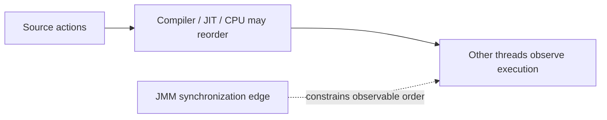

# 55. What is instruction reordering?

> Section: Java Memory Model · Java 8 baseline · [Section guide](README.md)

## Answer and deep dive

Compilers, the JIT, and processors may reorder independent operations when the result remains equivalent for a single thread. In concurrent code, another thread can observe outcomes that do not match a naïve reading of source-line order unless synchronization constrains them.

The JMM defines which observations are legal. Use locks, volatile fields, atomic APIs, or thread-safe handoff to establish required ordering rather than depending on a particular compiler or CPU.

```java
// A publication protocol needs a memory-ordering edge:
data = 42;
ready = true; // volatile write
```

## Mermaid: ordering as observed



## Pitfall / architect insight

Adding a sleep or checking that a test “usually passes” does not establish ordering. Reason from happens-before edges and validate the protocol, not one observed schedule.

## Related question

Next: [56. How do memory fences prevent reordering](56.%20How%20do%20memory%20fences%20prevent%20reordering.md).
