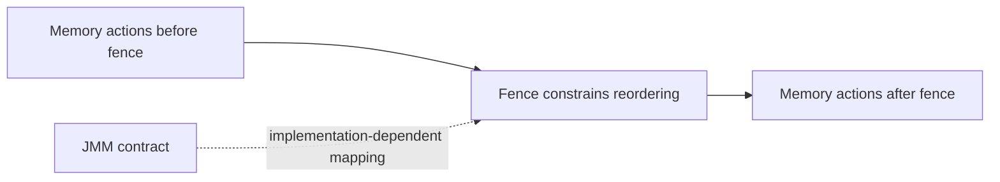

# 56. How do memory fences prevent reordering?

> Section: Java Memory Model · Java 8 baseline; direct `VarHandle` fence methods are Java 9+ · [Section guide](README.md)

## Answer and deep dive

A memory fence (barrier) constrains which memory operations may be reordered across a point and may participate in visibility guarantees. The JMM specifies required program outcomes; it does not prescribe one fence instruction for every operation. The JVM chooses target-specific mechanisms.

Application code should normally use higher-level constructs—volatile, locks, atomics, and thread-safe utilities—that state the intended synchronization. Direct fence operations are low-level; `VarHandle` exposes fence methods beginning in Java 9, not Java 8.

## Mermaid: fence boundary

## Pitfall / architect insight

A fence alone does not automatically make arbitrary data-race code correct: the protocol needs appropriate ordering and communication on all participants. Avoid platform-specific hand-written barriers in ordinary application code.

## Related question

Next: [57. How does the JVM insert fences implicitly](57.%20How%20does%20the%20JVM%20insert%20fences%20implicitly.md).
