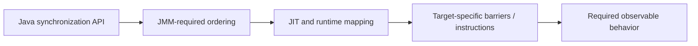

# 57. How does the JVM insert memory fences implicitly?

> Section: Java Memory Model · Java 8 baseline · [Section guide](README.md)

## Answer and deep dive

The Java compiler and JIT translate synchronization actions into the barriers, atomic instructions, and other target-specific operations needed to preserve JMM behavior. Monitor entry/exit, volatile access, and atomic APIs carry defined semantics; the runtime can optimize them while preserving those semantics.

```java
volatile int state;
void publish() { state = 1; } // compiler/runtime honor volatile semantics
```

Exactly which fences are emitted depends on the JVM, processor, and optimization. Correctness should depend on the language/API contract, not on inspecting machine code.

## Mermaid: API-to-hardware mapping



## Pitfall / architect insight

Do not emulate implicit fences with ordinary reads/writes or assume one architecture's behavior applies everywhere. Portable concurrency is expressed using Java synchronization primitives.

## Related question

Next: [58. Why is double-checked locking broken without volatile](58.%20Why%20is%20double-checked%20locking%20broken%20without%20volatile.md).
