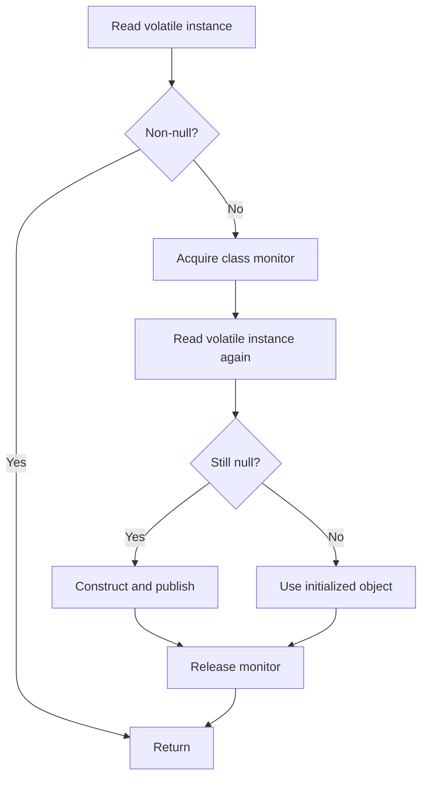

# 58. Why is double-checked locking broken without volatile?

> Section: Java Memory Model · Correct form supported since Java 5 · [Section guide](README.md)

## Answer and deep dive

Without a volatile reference, another thread may observe a stale value or see the reference become non-null without the constructor's writes being visible. The safe double-checked locking idiom requires a volatile field and a second check under the class monitor.

```java
private static volatile Service instance;

static Service get() {
    Service local = instance;
    if (local == null) {
        synchronized (Service.class) {
            local = instance;
            if (local == null) {
                instance = local = new Service();
            }
        }
    }
    return local;
}
```

The volatile publication provides visibility; synchronization ensures only one initialization wins. The local variable avoids repeated volatile reads on the fast path.

## Mermaid: double-check protocol



## Pitfall / architect insight

Do not remove `volatile` as an apparent optimization. For simple lazy singletons, the initialization-on-demand holder idiom is often easier to maintain.

## Related question

Next: [59. How are final fields treated specially](59.%20How%20are%20final%20fields%20treated%20specially.md).
