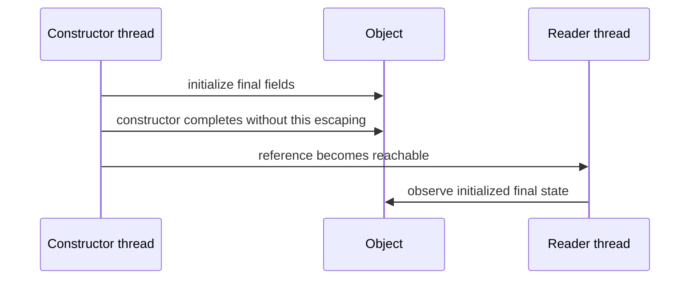

# 59. How are final fields treated specially by the JMM?

> Section: Java Memory Model · Java 8 baseline · [Section guide](README.md)

## Answer and deep dive

When an object is properly constructed—its constructor does not let `this` escape—the JMM gives special guarantees for its final fields. A thread that obtains the reference sees the initialized final values and certain state reachable through those fields as of construction completion, even without ordinary safe publication of the reference.

```java
final class Point {
    final int x;
    Point(int x) { this.x = x; }
}
```

The guarantee is about construction-time state. It does not make later mutation of an object referenced by a final field thread-safe.

## Mermaid: construction boundary



## Pitfall / architect insight

Avoid publishing `this` from a constructor (for example by registering a callback before initialization finishes). Final references are not the same as immutable object graphs.

## Related question

Next: [60. Why are final fields considered safe to publish](60.%20Why%20are%20final%20fields%20considered%20safe%20to%20publish.md).
