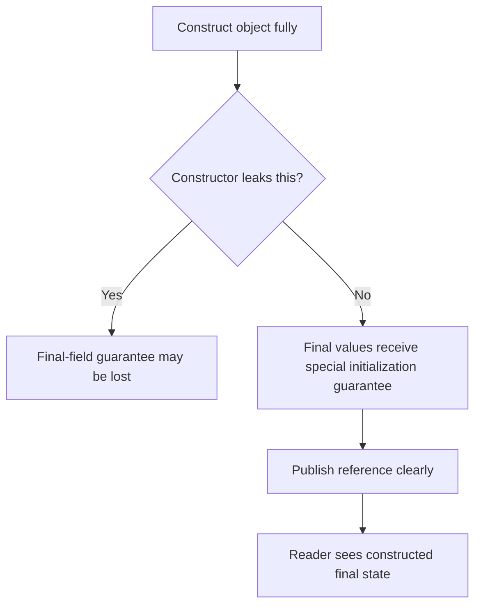

# 60. Why are final fields “safe to publish”?

> Section: Java Memory Model · Java 8 baseline · [Section guide](README.md)

## Answer and deep dive

Final-field semantics preserve the initialized value of a properly constructed object's final fields for a thread that obtains its reference, even if the reference itself was not published through a usual synchronization mechanism. This is a narrow construction-time guarantee, not a general replacement for safe publication.

Prefer an immutable object and publish its reference through a clear boundary such as a volatile field, synchronized access, class initialization, or a thread-safe queue:

```java
final class Settings {
    final int limit;
    Settings(int limit) { this.limit = limit; }
}
```

Never let `this` escape during construction. Mutable objects reachable through a final reference still need their own synchronization for later changes.

## Mermaid: safe construction and publication



## Pitfall / architect insight

Do not tell reviewers that “final makes this thread-safe.” Final fields help with initialization visibility; they do not protect subsequent mutation or establish a full lifecycle protocol.

## Related question

Previous: [59. How are final fields treated specially](59.%20How%20are%20final%20fields%20treated%20specially.md).
