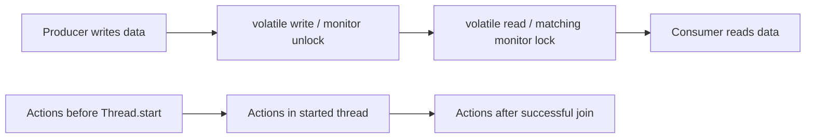
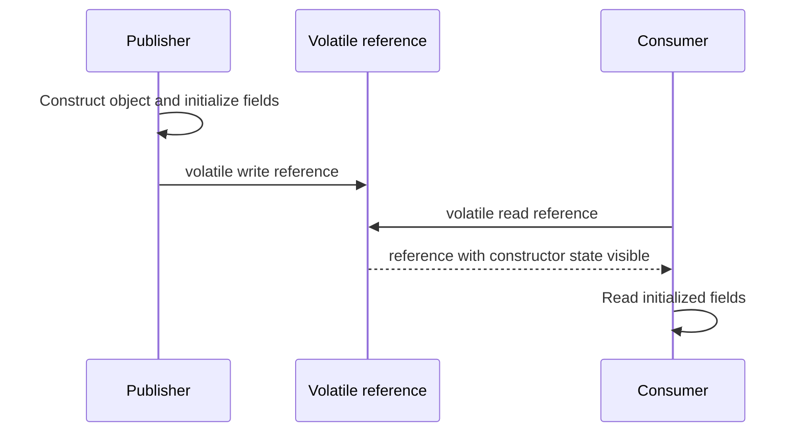
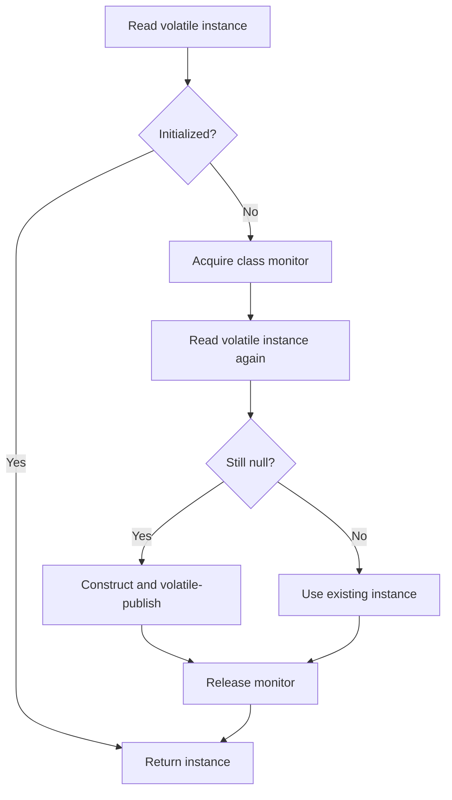

# 3. Java Memory Model

> Complete guide to questions 41–60 in the [master index](../00-INDEX.md). The Java Memory Model (JMM) defines legal inter-thread observations; it is not a description of one CPU's cache.

**Related code:** [`javamemorymodel`](../../src/com/java/javamemorymodel/), [`synchronization/App.java`](../../src/com/java/synchronization/App.java), [`Java Memory Model — Key Concepts`](../Java%20Memory%20Model%20—%20Key%20Concepts%20for%20Concurrency.MD).

## Answers

### 41. What is happens-before?

Happens-before is a partial order of actions that determines visibility and ordering guarantees. If action A happens-before B, effects of A are visible to B. Program order, monitor unlock/lock, volatile write/read, thread start/join, and transitivity create such edges. Without a happens-before path, conflicting unsynchronized accesses can be a data race.

### 42. How does `synchronized` establish happens-before?

An unlock of monitor M happens-before every subsequent lock of M. Writes before leaving a synchronized region are therefore visible to a later thread that enters a region guarded by the same monitor. Both operations must use the same monitor; synchronizing unrelated objects does not establish this edge.

### 43. How does `volatile` establish happens-before?

A write to volatile field V happens-before every subsequent read of V in synchronization order. The write/read pair publishes preceding writes to the reader. This is a one-way visibility/order guarantee; volatile does not make compound operations such as increment atomic.

### 44. How does `Thread.start()` establish happens-before?

All actions in the starting thread before `t.start()` happen-before actions in thread `t`. Initialize task state before starting, then the new thread can safely observe that state without an extra lock, provided it is not subsequently mutated unsafely.

### 45. How does `Thread.join()` establish happens-before?

All actions performed by a thread happen-before another thread successfully returns from `join()` on it. The joining thread can then inspect the completed task's results, assuming those results are not concurrently changed by other threads.

### 46. What guarantees does `volatile` provide?

Volatile reads and writes are individually atomic, reads observe a synchronization-ordered write, and volatile accesses constrain reordering around the field. It is appropriate for independent flags and publication protocols. It does not provide mutual exclusion, make related fields a consistent snapshot, or make read-modify-write atomic.

### 47. Why is volatile insufficient for increments?

`count++` is a read, addition, then write. Two threads can read the same old value and overwrite each other's increments; volatile only ensures each access is visible, not that this sequence is indivisible. Use `AtomicInteger`, a lock, or a suitable adder depending on semantics.

### 48. How does volatile prevent reordering?

The JMM constrains observable executions around volatile reads and writes: preceding actions cannot be published after a volatile write, and actions following a volatile read cannot be moved before it in a way that violates the specified semantics. The compiler/JVM emits whatever barriers the target requires; do not reason from one processor alone.

### 49. What is safe publication?

Safe publication makes a reference visible only after the object's invariants are established, using a happens-before mechanism: a static initializer, volatile reference, final field construction rules, synchronized handoff, or a thread-safe collection/queue. Safe publication does not make later unsynchronized mutation safe.

### 50. What is the out-of-thin-air problem?

An out-of-thin-air value would be an observed value with no valid causal source in the execution, often imagined from circular speculative reads. The JMM constrains causality so executions cannot justify arbitrary values through such cycles. This is a model-level safety constraint, not a practical synchronization technique.

### 51. Which operations are atomic?

Reads and writes of references and all primitive types are atomic in modern Java; `volatile` long/double accesses are atomic as well. Compound expressions are not automatically atomic. Use `Atomic*`, `VarHandle` operations, or locks for atomic read-modify-write and multi-field invariants.

### 52. Why did pre-Java 5 permit torn `long`/`double` accesses?

Older Java specifications permitted non-volatile 64-bit reads/writes to be treated as two 32-bit operations on some implementations. The modern Java Memory Model guarantees atomic reads and writes for all variables, including `long` and `double`; visibility and compound-operation safety still require coordination.

### 53. Atomicity, visibility, and ordering

Atomicity means an operation appears indivisible; visibility means another thread sees a write; ordering means observations respect required constraints. A volatile write/read supplies visibility and ordering for a publication edge but not atomic increment. A synchronized critical section supplies all three for its guarded invariant when all accesses follow the protocol.

### 54. How does synchronization guarantee visibility?

Monitor release flushes the synchronization action into the JMM order; a later acquisition of the same monitor observes actions that happened-before it. The guarantee is semantic, not necessarily a literal cache flush. Every read and write of the shared invariant must use the same synchronization discipline.

### 55. What is instruction reordering?

Compilers, the JIT, and processors may reorder independent operations when single-thread behavior remains equivalent. In multithreaded code, unsynchronized observations can expose those reorderings. Correct programs use JMM synchronization; adding arbitrary delays or relying on source-code line order does not establish cross-thread ordering.

### 56. How do memory fences prevent reordering?

A memory fence/barrier constrains which memory operations may move across a point and may affect visibility of writes. The JMM specifies outcomes, not a required fence instruction. Use language constructs such as volatile, locks, atomics, and VarHandles rather than handwritten platform-specific fences.

### 57. How does the JVM insert fences implicitly?

The compiler and JIT translate Java synchronization actions into the necessary target-specific barriers and atomic instructions, and may optimize them while preserving JMM behavior. Lock acquisition/release, volatile access, and atomic APIs carry these semantics. Application code should depend on the API contract, not inspect or emulate fence placement.

### 58. Why is double-checked locking broken without volatile?

Without a volatile reference, the publication of a newly constructed singleton can be reordered or observed stale: another thread could see a non-null reference before constructor writes are visible. Correct Java DCL declares the reference `volatile` and synchronizes initialization:

```java
private static volatile Service instance;
static Service get() {
    Service local = instance;
    if (local == null) {
        synchronized (Service.class) {
            local = instance;
            if (local == null) instance = local = new Service();
        }
    }
    return local;
}
```

Use the initialization-on-demand holder idiom instead when lazy initialization without reset semantics is sufficient.

### 59. How are final fields treated specially?

If an object is properly constructed (its constructor does not let `this` escape), final-field semantics ensure that a thread which obtains the reference sees the initialized final fields and certain state reachable through them as of construction completion. This special guarantee does not bless later mutation of referenced mutable objects.

### 60. Why are final fields considered safe to publish?

Final fields help preserve initialized state even when the reference itself is racy, but they are not a substitute for safe publication of the reference or for synchronization of mutable state. Prefer immutable objects and publish references through a clear synchronization boundary; never expose `this` from a constructor.

## Diagrams

### Common happens-before edges



### Safe publication with a volatile reference



### Double-checked initialization



## Review checklist

- Identify the shared state and draw the happens-before edge that protects each access.
- Treat volatile as a visibility/order primitive, not as a replacement for a compound atomic operation.
- Prefer immutable state and established concurrent utilities over custom publication protocols.
- Never claim correctness from a test that happened to observe a favorable interleaving.
