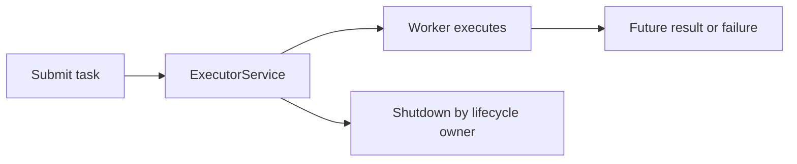

# 61. What is ExecutorService in Java?

> **Section:** Concurrency Utilities · **Java baseline:** 8 · [Guide answer](README.md#61-what-is-executorservice)

`ExecutorService` accepts tasks and manages their execution independently of the code that submits them. It can run `Runnable` or `Callable` tasks, return `Future`s, and coordinate orderly shutdown. It does not make shared task state safe and does not choose suitable capacity or overload behavior for an application.

```java
ExecutorService pool = Executors.newFixedThreadPool(4);
try {
    Future<Integer> result = pool.submit(() -> calculate());
    System.out.println(result.get(2, TimeUnit.SECONDS));
} finally {
    pool.shutdown();
}
```

Handle `ExecutionException` from `get()` by inspecting its cause; apply a timeout where waiting must be bounded.



**Architect insight / pitfall:** The component that creates a pool should own its shutdown. Prefer a configured `ThreadPoolExecutor` with bounded queue and explicit rejection policy for service workloads; convenience factories can hide unbounded queues or thread growth.

**Related:** [Fixed pool](README.md#62-how-do-you-create-a-fixed-thread-pool) · [Thread pools](README.md#65-why-use-thread-pools) · [Callable and Future](../1.%20Thread%20Fundamentals/13.%20How%20do%20you%20create%20a%20thread%20using%20Callable%20and%20Future.md)
