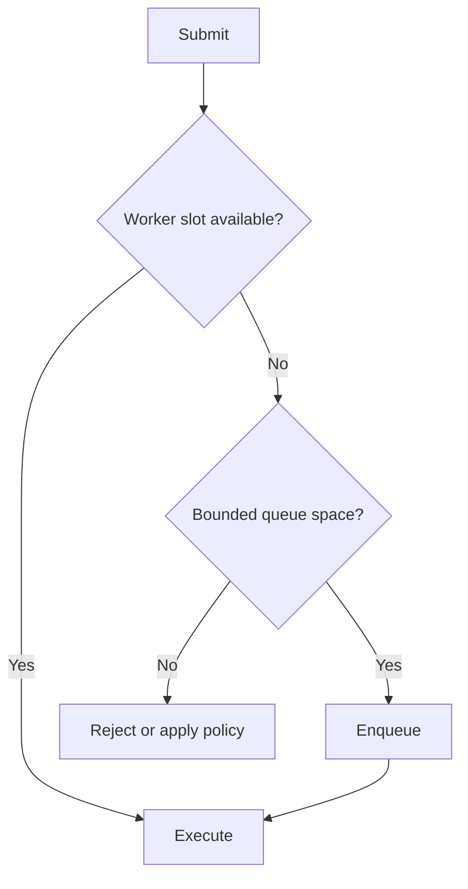

# 62. How do you create a fixed thread pool?

> **Section:** Concurrency Utilities · **Java baseline:** 8 · [Guide answer](README.md#62-how-do-you-create-a-fixed-thread-pool)

`Executors.newFixedThreadPool(n)` keeps at most `n` worker threads, but its shared work queue is unbounded. Under sustained overload, queued tasks can consume memory and wait ever longer. For bounded admission, configure the executor explicitly:

```java
ExecutorService pool = new ThreadPoolExecutor(
    4, 4, 0L, TimeUnit.MILLISECONDS,
    new ArrayBlockingQueue<Runnable>(200),
    new ThreadPoolExecutor.AbortPolicy());
```

`AbortPolicy` rejects excess work with `RejectedExecutionException`; other policies change where/how overload is handled. Select worker and queue sizes from measured workload, latency, and resource budgets.



**Architect insight / pitfall:** “Fixed” bounds workers, not pending work. Define rejection, metrics, shutdown, and caller behavior together; never treat an unbounded queue as backpressure.

**Related:** [ExecutorService](README.md#61-what-is-executorservice) · [Blocking queues](README.md#72-what-are-blocking-queues) · [Thread-pool rationale](README.md#65-why-use-thread-pools)
