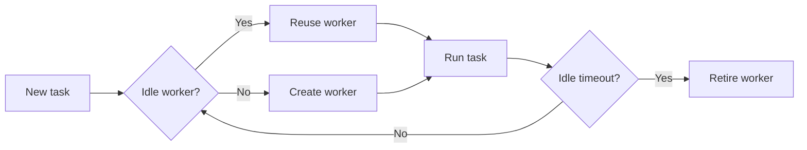

# 63. What is a cached thread pool?

> **Section:** Concurrency Utilities · **Java baseline:** 8 · [Guide answer](README.md#63-what-is-a-cached-thread-pool)

`Executors.newCachedThreadPool()` reuses idle workers and creates new workers when needed; idle workers are eventually retired. It uses direct handoff rather than a task backlog, but its maximum thread count is effectively unbounded. Many blocking or long-running submissions can therefore create too many threads.

```java
ExecutorService pool = Executors.newCachedThreadPool();
try {
    pool.execute(this::handleShortTask);
} finally {
    pool.shutdown();
}
```

Use only when concurrency is naturally bounded elsewhere and bursty short tasks fit the workload. Otherwise configure a `ThreadPoolExecutor` with explicit limits and a deliberate queue/rejection policy.



**Architect insight / pitfall:** A cached pool has no built-in concurrency ceiling. Never use it as a general server executor for unbounded input or blocking I/O; monitor active threads and reject or limit work upstream.

**Related:** [Fixed thread pool](README.md#62-how-do-you-create-a-fixed-thread-pool) · [Why use pools](README.md#65-why-use-thread-pools) · [ExecutorService](README.md#61-what-is-executorservice)
