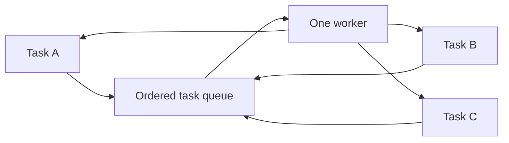

# 64. What is a single-threaded executor?

> **Section:** Concurrency Utilities · **Java baseline:** 8 · [Guide answer](README.md#64-what-is-a-single-threaded-executor)

`Executors.newSingleThreadExecutor()` runs tasks sequentially on one worker. Tasks execute in submission order, making it useful for a serialized event stream or state that must be accessed by one worker.

```java
ExecutorService serial = Executors.newSingleThreadExecutor();
try {
    serial.submit(() -> updateState(event));
} finally {
    serial.shutdown();
}
```

If its worker terminates due to failure, the executor can replace it; tasks are still serialized. A submitted `Runnable` failure is otherwise easy to miss unless observed with its `Future` or reported by task-level handling.



**Architect insight / pitfall:** The standard single-thread executor has an unbounded queue. Serial execution prevents concurrent access by that worker, but not concurrent access from other threads; bound/admit work deliberately and preserve ownership of the state.

**Related:** [Fixed pool](README.md#62-how-do-you-create-a-fixed-thread-pool) · [Blocking queues](README.md#72-what-are-blocking-queues) · [ExecutorService](README.md#61-what-is-executorservice)
