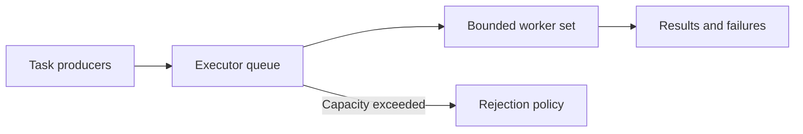

# 65. What is the advantage of using thread pools?

> **Section:** Concurrency Utilities · **Java baseline:** 8 · [Guide answer](README.md#65-why-use-thread-pools)

Pools amortize thread creation, manage concurrent task execution, centralize shutdown, and provide a place for queueing, rejection, and metrics. They help cap resource use only when configured to do so. Pools add scheduling overhead and do not make tasks thread-safe or automatically provide backpressure.

Use separate executors when CPU-bound work, blocking I/O, or latency-sensitive tasks have different resource and isolation needs. Submit bounded work and observe task failures.

**Architect insight / pitfall:** A single oversized shared pool can let blocking tasks starve unrelated work. Size pools from workload measurements and establish ownership, queue capacity, rejection, cancellation, and shutdown as part of the service contract.

**Related:** [ExecutorService](README.md#61-what-is-executorservice) · [Fixed pool](README.md#62-how-do-you-create-a-fixed-thread-pool) · [Fork/join](README.md#67-forkjoinpool-versus-a-normal-executor)
