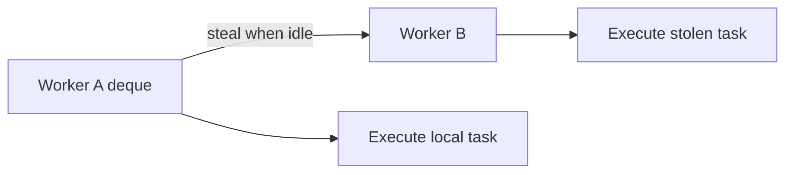

# 66. What is a work-stealing pool?

> **Section:** Concurrency Utilities · **Java baseline:** 8 · [Guide answer](README.md#66-what-is-a-work-stealing-pool)

A work-stealing pool gives workers local task deques. A worker usually takes its own work; an idle worker can steal tasks from another worker. This balances many small, independent tasks while reducing contention on a single shared queue. Java's `ForkJoinPool` implements this model.

```java
ForkJoinPool pool = new ForkJoinPool();
try {
    long total = pool.submit(() -> values.parallelStream()
        .mapToLong(this::score).sum()).get(5, TimeUnit.SECONDS);
} catch (ExecutionException | TimeoutException e) {
    // report or handle the failed/timed-out computation
} finally {
    pool.shutdown();
}
```

For fork/join, the common pool is often appropriate; custom pools require lifecycle ownership.



**Architect insight / pitfall:** Work stealing is not a cure for arbitrary blocking. Blocking I/O can occupy workers and starve computation; isolate it or use managed blocking where appropriate.

**Related:** [ForkJoinPool versus executor](README.md#67-forkjoinpool-versus-a-normal-executor) · [Fork/join workloads](README.md#68-what-is-forkjoin-best-suited-for)
