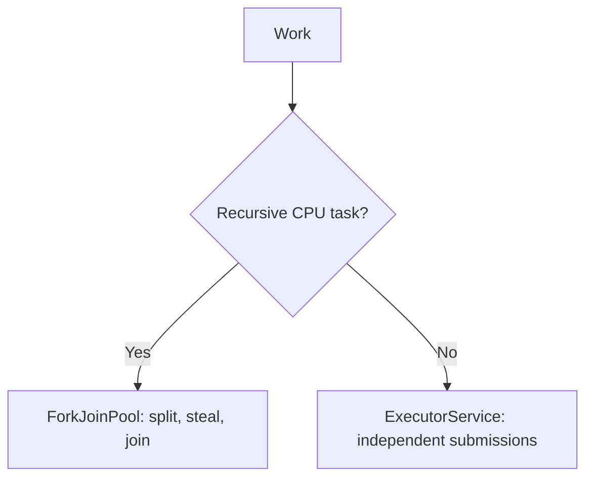

# 67. How does ForkJoinPool differ from normal executors?

> **Section:** Concurrency Utilities · **Java baseline:** 8 · [Guide answer](README.md#67-forkjoinpool-versus-a-normal-executor)

A conventional executor commonly draws independent tasks from a shared queue. `ForkJoinPool` is optimized for tasks that recursively split into subtasks and join their results; worker-local deques enable work stealing. Use the general executor for independent jobs and fork/join for decomposable computation.

```java
long total = ForkJoinPool.commonPool().submit(
    () -> values.parallelStream().mapToLong(this::score).sum()
).get();
```

Keep task granularity large enough to amortize splitting and joining. Prefer explicit executors for service tasks that need bounded queues and defined overload behavior.



**Architect insight / pitfall:** Fork/join workers may compensate for some managed blocking, but arbitrary blocking is not automatically safe. Blocking I/O can starve computation; isolate it from CPU work.

**Related:** [Work stealing](README.md#66-what-is-a-work-stealing-pool) · [Fork/join use cases](README.md#68-what-is-forkjoin-best-suited-for) · [Pool benefits](README.md#65-why-use-thread-pools)
