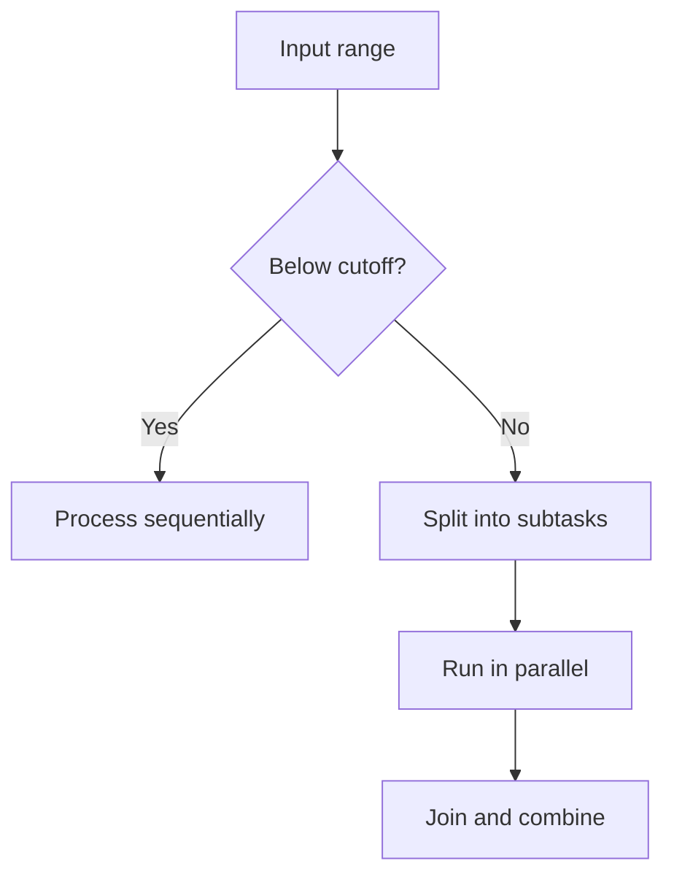

# 68. What is the fork/join framework best suited for?

> **Section:** Concurrency Utilities · **Java baseline:** 8 · [Guide answer](README.md#68-what-is-forkjoin-best-suited-for)

Fork/join is suited to CPU-bound divide-and-conquer work where independent subtasks can run concurrently and their results can be combined: for example, recursively processing sufficiently large array ranges. Use a sequential cutoff so small ranges do not pay excessive scheduling overhead.

```java
long sumRange(long[] a, int lo, int hi) {
    if (hi - lo <= 1_024) {
        long sum = 0;
        for (int i = lo; i < hi; i++) sum += a[i];
        return sum;
    }
    int mid = (lo + hi) >>> 1;
    return sumRange(a, lo, mid) + sumRange(a, mid, hi);
}
```

In a real fork/join task, the two recursive branches can fork one child and compute the other directly, then join.



**Architect insight / pitfall:** Avoid shared mutable accumulators and blocking I/O. Benchmark the cutoff and total input size; parallelism can slow small workloads.

**Related:** [ForkJoinPool](README.md#67-forkjoinpool-versus-a-normal-executor) · [Work stealing](README.md#66-what-is-a-work-stealing-pool)
