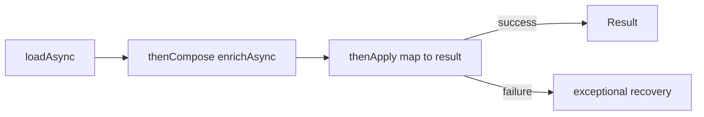

# 69. What is a CompletableFuture?

> **Section:** Concurrency Utilities · **Java baseline:** 8 · [Guide answer](README.md#69-what-is-completablefuture)

`CompletableFuture<T>` represents a value that may complete later and supports dependent transformations, combinations, and failure handling. It is part of Java 8. Non-async stages may run on the thread completing the prior stage; async stages without an executor generally use the common fork/join pool.

```java
CompletableFuture<Result> result =
    loadAsync(id, ioPool)
        .thenCompose(value -> enrichAsync(value, ioPool))
        .thenApply(this::toResult)
        .exceptionally(error -> fallback(error));
```

`thenCompose` flattens an asynchronous result; `thenApply` transforms a completed value. Choose executor and error policy intentionally.



**Architect insight / pitfall:** Async composition avoids caller-side blocking, not all blocking. A slow non-async callback can occupy a completion thread; keep callbacks short or select an explicit executor.

**Related:** [CompletableFuture versus Future](README.md#70-completablefuture-versus-future) · [Chaining stages](README.md#71-how-do-you-chain-async-tasks)
