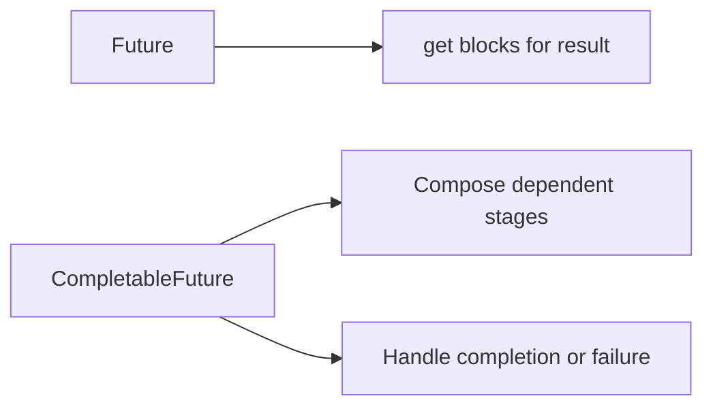

# 70. How does CompletableFuture differ from Future?

> **Section:** Concurrency Utilities · **Java baseline:** 8 · [Guide answer](README.md#70-completablefuture-versus-future)

`Future<T>` offers completion status, cancellation attempts, and result retrieval. Calling `get()` blocks, and task failures are wrapped in `ExecutionException`. `CompletableFuture<T>` implements `Future` and adds explicit completion plus composable dependent stages, allowing asynchronous workflows without blocking after every step.

```java
Future<String> f = pool.submit(this::fetch); // retrieve with timed get()
CompletableFuture<String> cf =
    CompletableFuture.supplyAsync(this::fetch, ioPool)
        .thenApply(this::normalize);
```

For `Future.get`, bound waiting and handle `TimeoutException`, `InterruptedException` (restore or propagate), and `ExecutionException` (inspect cause).



**Architect insight / pitfall:** Neither abstraction guarantees that cancellation stops an underlying operation or establishes resource ownership. Define timeouts and cancellation at the operation boundary; don't assume `CompletableFuture.cancel` interrupts work.

**Related:** [CompletableFuture](README.md#69-what-is-completablefuture) · [Chaining async tasks](README.md#71-how-do-you-chain-async-tasks) · [Callable and Future](../1.%20Thread%20Fundamentals/13.%20How%20do%20you%20create%20a%20thread%20using%20Callable%20and%20Future.md)
