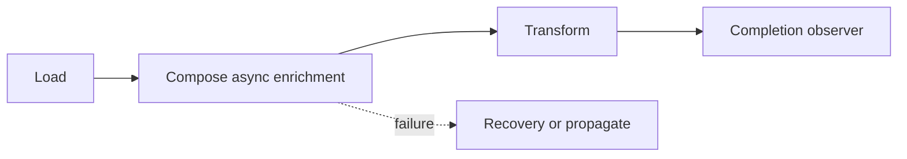

# 71. How do you chain async tasks with CompletableFuture?

> **Section:** Concurrency Utilities · **Java baseline:** 8 · [Guide answer](README.md#71-how-do-you-chain-async-tasks)

Use `thenApply` for a synchronous value transformation, `thenCompose` when the next function returns another `CompletionStage`, and `thenCombine` for independent stages whose results are joined. `*Async` variants schedule the callback; pass an explicit executor when its workload needs isolation.

```java
CompletableFuture<Result> result =
    loadAsync(id, ioPool)
        .thenCompose(value -> enrichAsync(value, ioPool))
        .thenApply(this::toResult)
        .whenComplete((value, error) -> logCompletion(error));
```

Failures can be observed or recovered using `whenComplete`, `handle`, or `exceptionally`; choose whether recovery should produce a fallback or preserve exceptional completion.



**Architect insight / pitfall:** A non-async callback may execute on a completion thread. Keep it fast; don't accidentally run blocking work on a latency-sensitive producer or common-pool worker.

**Related:** [CompletableFuture](README.md#69-what-is-completablefuture) · [Future comparison](README.md#70-completablefuture-versus-future)
