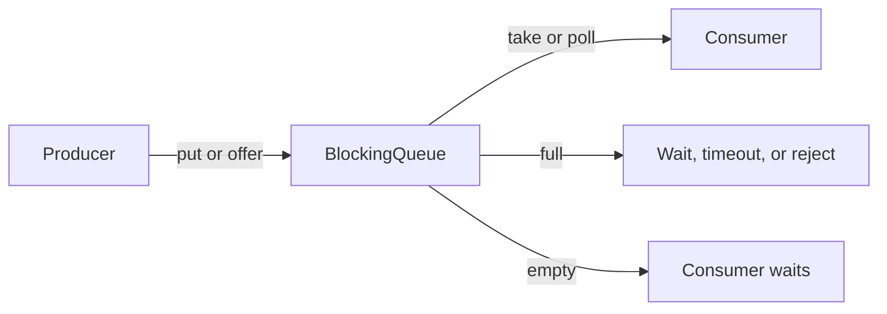

# 72. What are blocking queues in Java concurrency?

> **Section:** Concurrency Utilities · **Java baseline:** 8 · [Guide answer](README.md#72-what-are-blocking-queues)

`BlockingQueue<E>` is a thread-safe producer/consumer handoff. `put` and `take` wait for capacity or an available element; timed `offer`/`poll` bound the wait; immediate `offer`/`poll` return without blocking.

```java
BlockingQueue<Job> queue = new ArrayBlockingQueue<>(100);
if (!queue.offer(job, 200, TimeUnit.MILLISECONDS)) {
    reject(job); // explicit overload behavior
}
Job next = queue.take();
```

Bounded queues can propagate backpressure or reject overload. An unbounded queue postpones the problem until memory use and latency grow.



**Architect insight / pitfall:** Queue capacity is a latency and memory policy, not merely a tuning knob. Define what producers do when full, and handle interruption when blocking operations are cancelled.

**Related:** [Array versus linked queue](README.md#73-arrayblockingqueue-versus-linkedblockingqueue) · [SynchronousQueue](README.md#75-how-does-synchronousqueue-work) · [Fixed pool](README.md#62-how-do-you-create-a-fixed-thread-pool)
