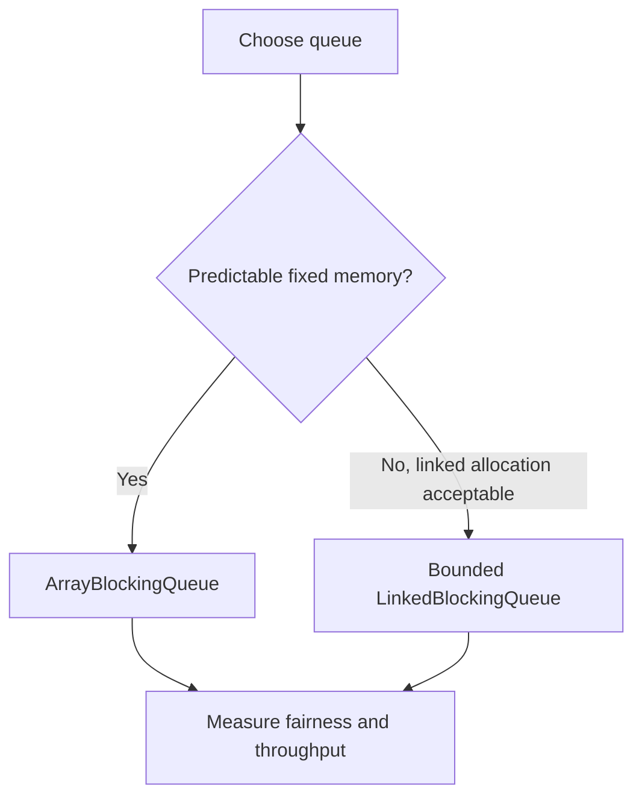

# 73. When to use ArrayBlockingQueue vs LinkedBlockingQueue?

> **Section:** Concurrency Utilities · **Java baseline:** 8 · [Guide answer](README.md#73-arrayblockingqueue-versus-linkedblockingqueue)

`ArrayBlockingQueue` is array-backed with fixed capacity and predictable storage; fairness can be enabled at additional throughput cost. `LinkedBlockingQueue` is node-backed, allocates per element, and can be bounded with a constructor capacity or effectively unbounded by default. Its put/take sides use separate locks.

```java
BlockingQueue<Task> predictable = new ArrayBlockingQueue<>(500);
BlockingQueue<Task> linkedBounded = new LinkedBlockingQueue<>(500);
```

Both are thread-safe and block according to queue operations. Choose based on memory, capacity, and measured producer/consumer performance—not assumptions.



**Architect insight / pitfall:** The no-argument `LinkedBlockingQueue` has a very large effective capacity. Specify a bound for overload control and benchmark the actual access pattern.

**Related:** [BlockingQueue basics](README.md#72-what-are-blocking-queues) · [PriorityBlockingQueue](README.md#74-what-is-priorityblockingqueue)
