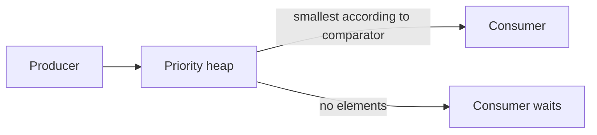

# 74. What is a PriorityBlockingQueue?

> **Section:** Concurrency Utilities · **Java baseline:** 8 · [Guide answer](README.md#74-what-is-priorityblockingqueue)

`PriorityBlockingQueue<E>` is a thread-safe, unbounded priority heap. Elements are removed according to natural ordering or a comparator, not FIFO. Equal-priority ordering is unspecified. A consumer blocks when empty, but insertion does not provide a fixed-capacity backpressure boundary.

```java
PriorityBlockingQueue<Job> jobs =
    new PriorityBlockingQueue<>(11, Comparator.comparingInt(Job::priority));
jobs.offer(job);
Job highestPriority = jobs.take();
```

Make comparator ordering stable and avoid mutating fields that determine an element's priority while it is enqueued.



**Architect insight / pitfall:** The constructor's initial capacity is not a maximum. Use admission control or an external bound if producers can outpace consumers; add aging if low-priority work must not starve.

**Related:** [Blocking queues](README.md#72-what-are-blocking-queues) · [Array versus linked queue](README.md#73-arrayblockingqueue-versus-linkedblockingqueue)
