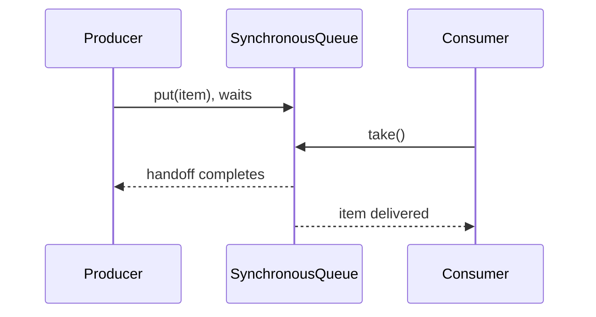

# 75. How does SynchronousQueue work?

> **Section:** Concurrency Utilities · **Java baseline:** 8 · [Guide answer](README.md#75-how-does-synchronousqueue-work)

`SynchronousQueue<E>` has no storage capacity. Each successful insertion must rendezvous directly with a consumer's removal; it is a handoff, not a buffer. Depending on the operation, a producer may wait or a nonblocking offer may fail if no consumer is ready.

```java
SynchronousQueue<String> handoff = new SynchronousQueue<>();
boolean accepted = handoff.offer(message, 100, TimeUnit.MILLISECONDS);
if (!accepted) handleNoWaitingConsumer();
```

It is useful when queue buildup is undesirable and direct transfer is appropriate.



**Architect insight / pitfall:** A handoff does not cap worker creation if paired with an executor that responds by spawning workers. Bound concurrency separately and specify what happens when handoff cannot occur.

**Related:** [Blocking queues](README.md#72-what-are-blocking-queues) · [Cached thread pool](README.md#63-what-is-a-cached-thread-pool)
