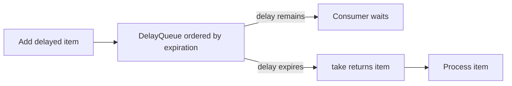

# 76. What is a DelayQueue used for?

> **Section:** Concurrency Utilities · **Java baseline:** 8 · [Guide answer](README.md#76-what-is-delayqueue-for)

`DelayQueue<E extends Delayed>` is an unbounded blocking priority queue. Its head is the element with the shortest remaining delay; `take()` waits until that delay expires. Elements implement `getDelay` and ordering, and should report delay consistently.

```java
Delayed expired = delayQueue.take(); // waits until eligible
process(expired);
```

It can represent retry eligibility, leases, and expirations, but it is in-memory and does not execute tasks exactly on a deadline. Use a scheduled executor for task scheduling and durable storage for durable timers.



**Architect insight / pitfall:** It has no capacity bound and is not a scheduler with persistence or crash recovery. Bound admission and define how shutdown, clock changes, and missed work are handled.

**Related:** [Scheduling tasks](README.md#80-how-do-you-schedule-tasks) · [Blocking queues](README.md#72-what-are-blocking-queues)
