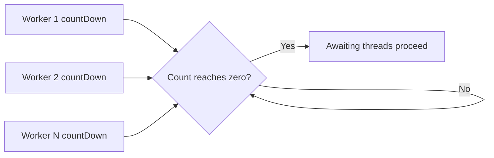

# 77. How does CountDownLatch work?

> **Section:** Concurrency Utilities · **Java baseline:** 8 · [Guide answer](README.md#77-how-does-countdownlatch-work)

A `CountDownLatch` starts with a fixed count. Each `countDown()` decrements it; threads in `await()` proceed once it reaches zero. It is one-shot and is useful for a start gate or waiting for a known set of tasks.

```java
CountDownLatch done = new CountDownLatch(3);
for (int i = 0; i < 3; i++) pool.submit(() -> {
    try { work(); } finally { done.countDown(); }
});
if (!done.await(5, TimeUnit.SECONDS)) handleTimeout();
```

The `finally` ensures completion is signalled even when work fails; observe failures separately using returned `Future`s or task-level reporting.



**Architect insight / pitfall:** A latch cannot be reset. A worker that never decrements can block waiters forever; use timeouts and ensure every completion path counts down.

**Related:** [CyclicBarrier](README.md#78-cyclicbarrier-versus-countdownlatch) · [Phaser](README.md#79-what-is-a-phaser) · [ExecutorService](README.md#61-what-is-executorservice)
