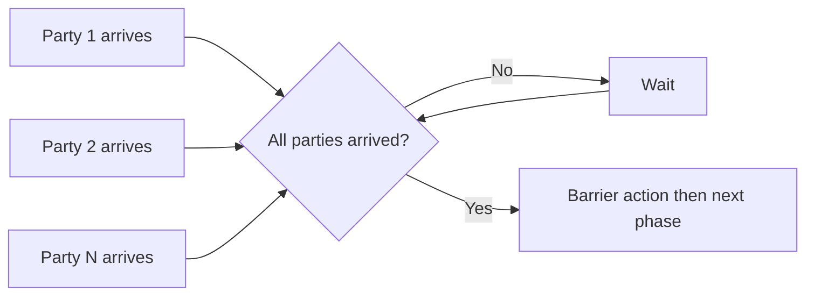

# 78. How does CyclicBarrier differ from CountDownLatch?

> **Section:** Concurrency Utilities · **Java baseline:** 8 · [Guide answer](README.md#78-cyclicbarrier-versus-countdownlatch)

A `CountDownLatch` is one-shot: independent workers decrement a fixed count and waiters pass at zero. A `CyclicBarrier` is a reusable rendezvous: a fixed number of parties wait for one another at each phase, optionally triggering a barrier action.

```java
CyclicBarrier barrier = new CyclicBarrier(parties, this::combinePhase);
runPhase();
barrier.await(2, TimeUnit.SECONDS);
```

Timeout or interruption can break a barrier and cause waiting parties to fail. Decide how the application detects and recovers from a broken phase.



**Architect insight / pitfall:** Use a latch to await completion, not to synchronize repeating phases. Use a barrier only when party count and phase participation are well-defined; one missing party can stall everyone.

**Related:** [CountDownLatch](README.md#77-how-does-countdownlatch-work) · [Phaser](README.md#79-what-is-a-phaser)
