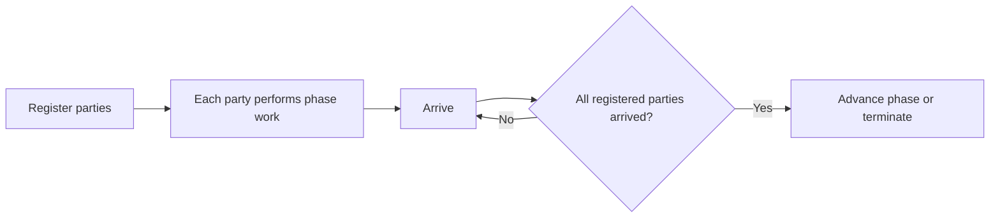

# 79. What is a Phaser?

> **Section:** Concurrency Utilities · **Java baseline:** 8 · [Guide answer](README.md#79-what-is-a-phaser)

`Phaser` is a reusable phase barrier with a dynamically changing number of registered parties. Parties register, arrive, await phase advancement, or deregister when finished. It is useful for staged algorithms whose participants vary between phases.

```java
Phaser phaser = new Phaser(1); // coordinator party
phaser.register();
try {
    doPhaseWork();
} finally {
    phaser.arriveAndDeregister();
}
int phase = phaser.arriveAndAwaitAdvance();
```

The coordinator's registration must also be balanced; use timed arrival/wait APIs when indefinite waits are unacceptable.



**Architect insight / pitfall:** A party that never arrives can hold the phase indefinitely. Define deregistration, termination, interruption, and timeout behavior as carefully as registration.

**Related:** [CyclicBarrier](README.md#78-cyclicbarrier-versus-countdownlatch) · [CountDownLatch](README.md#77-how-does-countdownlatch-work)
