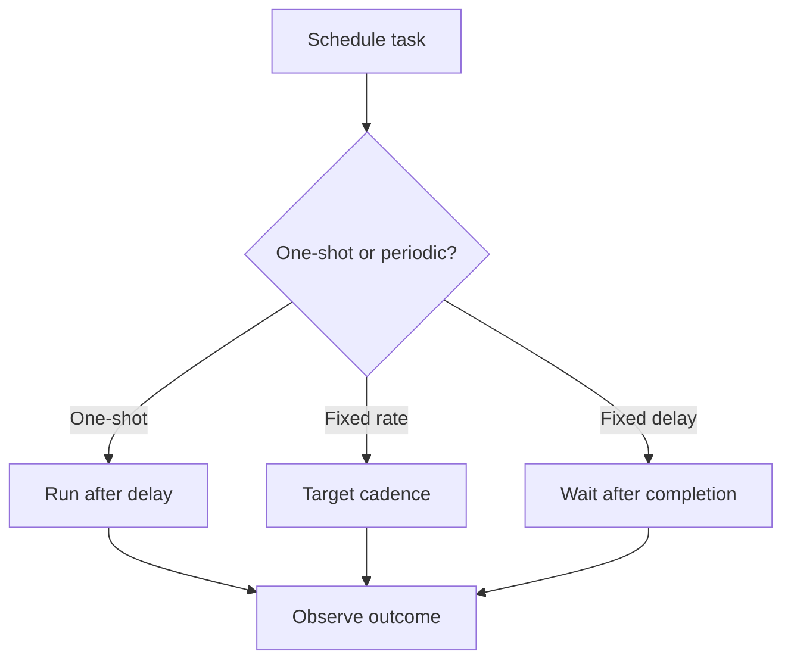

# 80. How do you schedule tasks with ScheduledExecutorService?

> **Section:** Concurrency Utilities · **Java baseline:** 8 · [Guide answer](README.md#80-how-do-you-schedule-tasks)

`ScheduledExecutorService` schedules one-shot delayed actions, fixed-rate repetitions, and fixed-delay repetitions. Fixed rate targets a recurring cadence; fixed delay waits the requested interval after an execution completes.

```java
ScheduledExecutorService scheduler =
    Executors.newScheduledThreadPool(2);
ScheduledFuture<?> task = scheduler.scheduleWithFixedDelay(
    this::pollSafely, 0, 1, TimeUnit.SECONDS);
```

An exception escaping a periodic action suppresses later executions. Catch and report expected failures in the action; do not silently discard them. Shut down the scheduler through its lifecycle owner.



**Architect insight / pitfall:** Fixed rate does not guarantee exact timing or parallel executions of the same periodic task; long runs can make it fall behind. Decide whether cadence or a quiet interval after each run is desired.

**Related:** [DelayQueue](README.md#76-what-is-delayqueue-for) · [ExecutorService](README.md#61-what-is-executorservice)
