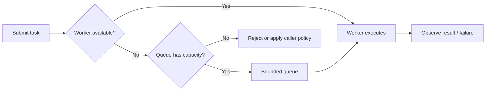
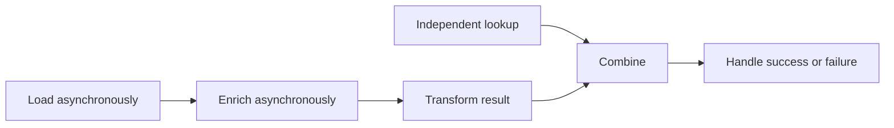
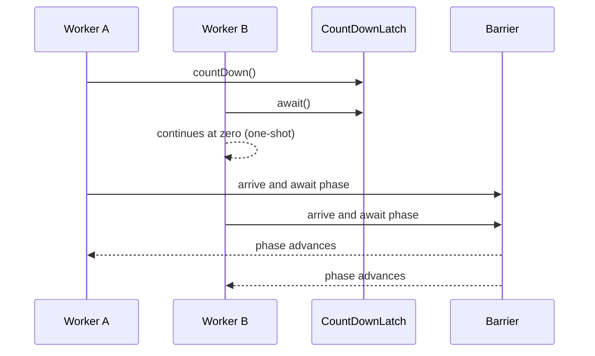

# 4. Concurrency Utilities

> Complete guide to questions 61–80 in the [master index](../00-INDEX.md). Examples use standard JDK APIs; size pools and queues from workload measurements rather than guesswork.

**Related code:** [`threadpools/App.java`](../../src/com/java/threadpools/App.java), [`countdownlatches/App.java`](../../src/com/java/countdownlatches/App.java), [`producerconsumer`](../../src/com/java/producerconsumer/).

**Runnable demonstration:** [`CoordinationUtilitiesDemo.java`](../../src/com/java/concurrency/CoordinationUtilitiesDemo.java) demonstrates `CyclicBarrier`, `Phaser`, and `ScheduledExecutorService`.

## Answers

### 61. What is `ExecutorService`?

`ExecutorService` separates task submission from thread management. It accepts `Runnable` and `Callable` work, returns `Future`s for submitted work, and provides orderly shutdown. The owner must define lifecycle, rejection, queue capacity, cancellation, and error observation; a pool does not make task code itself thread-safe.

### 62. How do you create a fixed thread pool?

`Executors.newFixedThreadPool(n)` uses a fixed number of workers but an unbounded shared queue, so it can accumulate unbounded latency and memory under overload. For production services requiring backpressure, configure `ThreadPoolExecutor` explicitly with a bounded queue and a deliberate rejection policy.

```java
ExecutorService pool = new ThreadPoolExecutor(
    4, 4, 0L, TimeUnit.MILLISECONDS,
    new ArrayBlockingQueue<Runnable>(200),
    new ThreadPoolExecutor.AbortPolicy());
```

Always shut down the pool from its lifecycle owner.

### 63. What is a cached thread pool?

`newCachedThreadPool()` creates workers as needed and reuses idle ones, with no fixed maximum worker count. It suits many short, bursty tasks only when concurrency is naturally bounded elsewhere. Under sustained overload or blocking tasks it can create an excessive number of threads; explicit limits are safer for servers.

### 64. What is a single-threaded executor?

A single-thread executor runs submitted tasks sequentially on one worker and preserves submission order. It is useful for serializing access to state or processing an ordered event stream. It has an unbounded queue in the standard factory, so producers still need an overload policy and task failures should be observed.

### 65. Why use thread pools?

Pools amortize thread creation, cap or manage concurrency, centralize lifecycle, and enable task queues, metrics, and rejection. They do not eliminate scheduling cost or provide backpressure automatically. Separate pools by workload when blocking, CPU-bound, latency-sensitive, or differently trusted tasks would otherwise starve one another.

### 66. What is a work-stealing pool?

Workers maintain task deques and can steal work from peers when idle, balancing many small tasks with low coordination overhead. `ForkJoinPool` uses this model. Work stealing is most effective for recursive or decomposable tasks; blocking I/O can starve workers unless managed explicitly or isolated.

### 67. `ForkJoinPool` versus a normal executor

A conventional executor usually has a shared queue; `ForkJoinPool` emphasizes recursive task splitting, per-worker deques, and work stealing. Its workers can compensate for some managed blocking, but arbitrary blocking is not automatically safe. Choose a general `ExecutorService` for independent tasks and fork/join for divide-and-conquer workloads.

### 68. What is fork/join best suited for?

Fork/join suits CPU-bound work that divides into independent subtasks and combines results, such as parallel reduction over sufficiently large arrays. Task granularity must amortize scheduling and joining overhead. Avoid shared mutable accumulators, excessive recursion, and blocking I/O; set a sequential cutoff for small inputs.

### 69. What is `CompletableFuture`?

`CompletableFuture` represents a result that may complete later and provides composable callbacks for transformations, combination, and error recovery. Non-async stages may execute on the thread completing the prior stage. Async stages without an explicit executor commonly use the shared common pool.

### 70. `CompletableFuture` versus `Future`

`Future` provides result retrieval, cancellation, and completion status, typically by blocking in `get()`. `CompletableFuture` also supports explicit completion and a graph of dependent stages without requiring each caller to block. Neither automatically cancels an underlying operation reliably, nor does either define application-level timeouts or resource ownership by itself.

### 71. How do you chain async tasks?

Use `thenApply` for synchronous transformation, `thenCompose` to flatten an asynchronous result, and `thenCombine` to join independent stages. Use `*Async` when execution must be scheduled, preferably with an explicit executor. Handle failures via `exceptionally`, `handle`, or `whenComplete`, and preserve cancellation/timeout policy.

```java
CompletableFuture<Result> result =
    loadAsync(id, ioPool)
        .thenCompose(value -> enrichAsync(value, ioPool))
        .thenApply(this::toResult)
        .whenComplete((value, error) -> logCompletion(error));
```

### 72. What are blocking queues?

`BlockingQueue` is a thread-safe producer/consumer handoff abstraction. `put`/`take` wait for capacity/data; timed methods bound waiting; `offer`/`poll` return promptly. A bounded queue can apply backpressure, while an unbounded queue only delays overload until memory or latency becomes unacceptable.

### 73. `ArrayBlockingQueue` versus `LinkedBlockingQueue`

`ArrayBlockingQueue` is fixed-capacity and array-backed, with predictable memory and optional fairness. `LinkedBlockingQueue` is node-backed and may be bounded or effectively unbounded; it has separate put/take locks and additional allocation overhead. Choose capacity explicitly and benchmark the real producer/consumer pattern.

### 74. What is `PriorityBlockingQueue`?

It is an unbounded blocking heap that removes elements according to natural order or a comparator, not FIFO order. Equal-priority order is not guaranteed. Since it has no fixed capacity, protect it with admission control if work can arrive faster than it is processed.

### 75. How does `SynchronousQueue` work?

It has no storage capacity: each insertion must rendezvous directly with a consumer removal. It is useful for direct handoff and can prevent queue buildup, but producers may block or submissions may be rejected. It is used by some cached-thread-pool designs.

### 76. What is `DelayQueue` for?

`DelayQueue` is an unbounded priority queue of `Delayed` elements; `take()` yields only elements whose delay has expired. It is useful for timers, expirations, and retry eligibility, but is not a durable scheduler and does not itself guarantee execution at an exact deadline.

### 77. How does `CountDownLatch` work?

A latch starts at a fixed count. Each `countDown()` decrements it; waiters on `await()` proceed when it reaches zero. It is one-shot, useful for startup gates and completion aggregation, and its memory-consistency effects publish actions before countdown to threads that successfully pass `await()`.

### 78. `CyclicBarrier` versus `CountDownLatch`

A latch is one-shot and can be counted down by unrelated workers. A barrier is a reusable rendezvous: a fixed number of parties wait at each phase, optionally running a barrier action. A broken barrier (for example, a timed-out or interrupted party) fails waiting parties and needs deliberate recovery.

### 79. What is a `Phaser`?

A `Phaser` is a flexible reusable phase barrier whose party count can change dynamically. Parties register, arrive, await advancement, or deregister. It suits staged algorithms with changing participants; define termination and interruption/timeout behavior because a party that never arrives can hold a phase indefinitely.

### 80. How do you schedule tasks?

`ScheduledExecutorService` supports one-shot delayed tasks and fixed-rate or fixed-delay repetition. Fixed rate targets a cadence; fixed delay waits after each execution completes. An uncaught exception in a periodic task suppresses later executions, so catch only expected failures and report them explicitly; shut down the scheduler cleanly.

## Diagrams

### Bounded executor lifecycle



### CompletableFuture pipeline



### Latch and barrier coordination



## Operational checklist

- Bound work admission as well as worker count; queue length is a latency and memory decision.
- Give every executor an owner, a named thread factory, metrics, a rejection policy, and a shutdown path.
- Keep blocking operations off CPU-focused pools; use explicit executors for important async boundaries.
- Observe every `Future`/`CompletableFuture` failure and cancellation rather than assuming submission means success.
