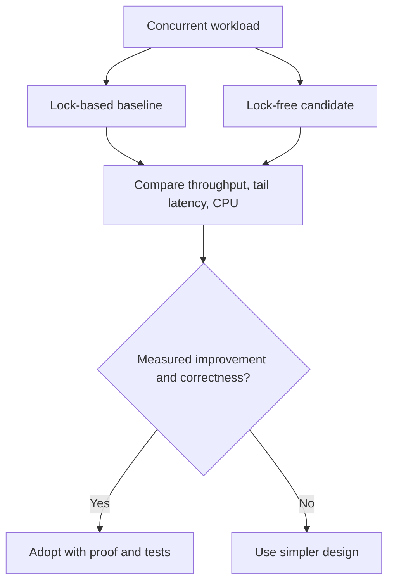

# 100. How can lock-free structures improve throughput?

> **Section:** Atomic Operations and Lock-Free · **Java baseline:** 8 atomic APIs; `VarHandle` Java 9+ · [Guide answer](README.md#100-how-can-lock-free-structures-improve-throughput)

Lock-free structures can let operations proceed without serializing every thread behind a mutex. That can help when operations are short, contention is high, and the algorithm spreads updates effectively. CAS retries and cache-coherence traffic can instead reduce throughput, particularly around one hot location.

Measure against JDK concurrent structures and a lock-based baseline under realistic arrival rates and data distributions. Track throughput, tail latency, CPU use, and fairness.

**Architect insight /pitfall:** A throughput win does not justify unbounded retry CPU or starvation. Document linearizability and progress guarantees, and keep the simpler implementation if it meets service goals.

**Related:** [Benefits](README.md#96-benefits-of-lock-free-programming) · [Risks](README.md#97-risks-of-lock-free-programming) · [CAS failures](README.md#99-what-if-cas-fails-repeatedly)
