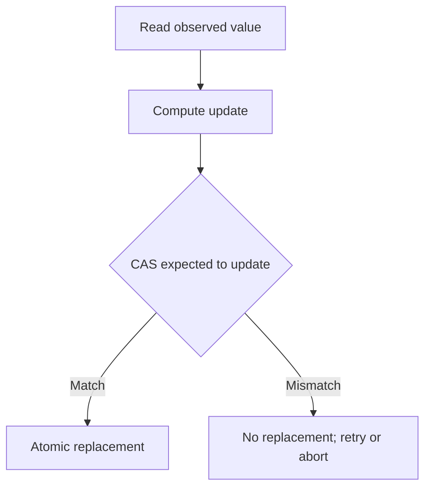

# 81. What is CAS (Compare-And-Swap)?

> **Section:** Atomic Operations and Lock-Free · **Java baseline:** 8 · [Guide answer](README.md#81-what-is-cas)

Compare-and-set (CAS) atomically compares a location with an expected value and replaces it only if they match. It returns success or failure. The successful CAS can be the linearization point of a state transition.

```java
AtomicInteger count = new AtomicInteger();
boolean changed = count.compareAndSet(0, 1);
```

CAS alone does not make a multi-variable invariant atomic, guarantee lock-free progress, or eliminate ABA. On failure, the caller must decide whether to retry using a fresh value or report contention.



**Architect insight / pitfall:** Never assume CAS failure means a particular competing update occurred; reread state and recompute any derived value.

**Related:** [Lock avoidance](README.md#82-how-does-cas-avoid-locks) · [ABA](README.md#92-what-is-the-aba-problem) · [AtomicInteger](README.md#83-what-is-atomicinteger-used-for)
