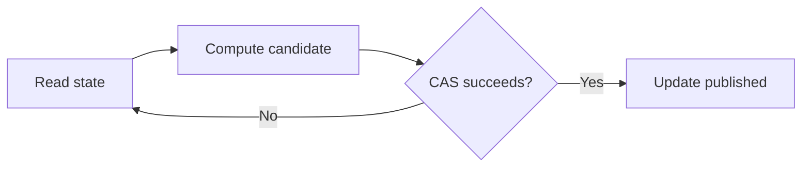

# 82. How does CAS help avoid locks?

> **Section:** Atomic Operations and Lock-Free · **Java baseline:** 8 · [Guide answer](README.md#82-how-does-cas-avoid-locks)

A CAS-based update reads a snapshot, computes a candidate state, then atomically installs it only if the snapshot is still current. If another thread wins first, this thread retries from the new state. Threads do not wait for a mutex, but contention can cause repeated work.

```java
AtomicInteger value = new AtomicInteger();
value.updateAndGet(current -> current + 1);
```

The JDK update method may invoke its function more than once, so the function should be side-effect-free. For larger invariants, immutable aggregate state in an `AtomicReference` may help, but does not remove algorithmic complexity.



**Architect insight / pitfall:** “No lock” does not imply wait-free or fast. CAS loops may starve individual threads and burn CPU; use a lock if it provides simpler, measured, adequate behavior.

**Related:** [CAS](README.md#81-what-is-cas) · [Progress benefits](README.md#96-benefits-of-lock-free-programming) · [Repeated CAS failure](README.md#99-what-if-cas-fails-repeatedly)
