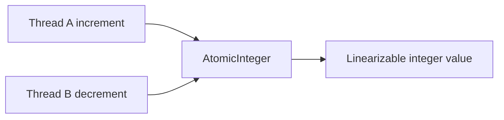

# 83. What is AtomicInteger used for?

> **Section:** Atomic Operations and Lock-Free · **Java baseline:** 8 · [Guide answer](README.md#83-what-is-atomicinteger-used-for)

`AtomicInteger` provides atomic integer reads, writes, compare-and-set, and read-modify-write operations such as `incrementAndGet`. Use it for a standalone concurrent counter or a single integer state transition.

```java
AtomicInteger active = new AtomicInteger();
int nowActive = active.incrementAndGet();
try {
    handle();
} finally {
    active.decrementAndGet();
}
```

Every update is visible as a single atomic operation. For a custom conditional transition, use CAS and recompute from the latest value after failure.



**Architect insight / pitfall:** Atomicity covers this integer only. It cannot preserve an invariant spanning multiple fields; guard the whole invariant with a lock or atomically replace one immutable aggregate reference.

**Related:** [AtomicLong](README.md#84-what-is-atomiclong) · [AtomicReference](README.md#85-what-is-atomicreference) · [CAS](README.md#81-what-is-cas)
