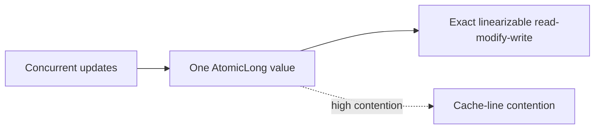

# 84. What is AtomicLong?

> **Section:** Atomic Operations and Lock-Free · **Java baseline:** 8 · [Guide answer](README.md#84-what-is-atomiclong)

`AtomicLong` provides atomic long-valued reads, writes, compare-and-set, and arithmetic updates. Use it when each operation must observe/update one linearizable value, such as a sequence number or state variable.

```java
AtomicLong sequence = new AtomicLong();
long id = sequence.incrementAndGet();
```

A single contended atomic may become a cache-coherence hotspot. For high-contention statistical aggregation where a concurrent sum need not be an instantaneous atomic snapshot, consider `LongAdder` instead.



**Architect insight / pitfall:** Do not replace an exact sequence or decision-making state with an adder: `LongAdder.sum()` is not an atomic snapshot while updates continue.

**Related:** [LongAdder versus AtomicLong](README.md#88-longadder-versus-atomiclong) · [CAS](README.md#81-what-is-cas)
